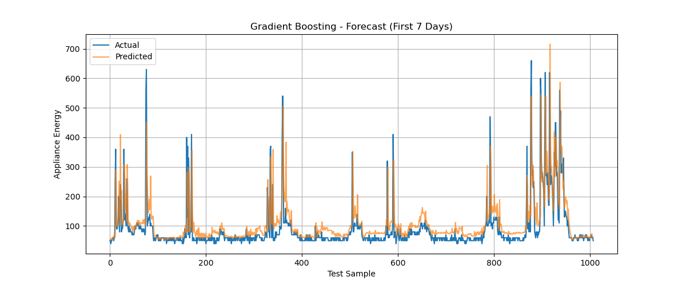
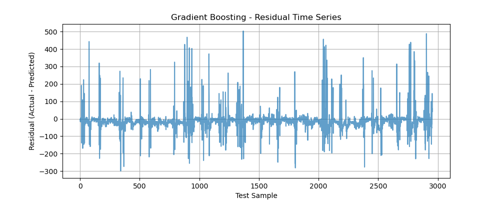
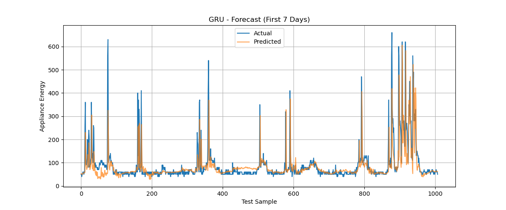
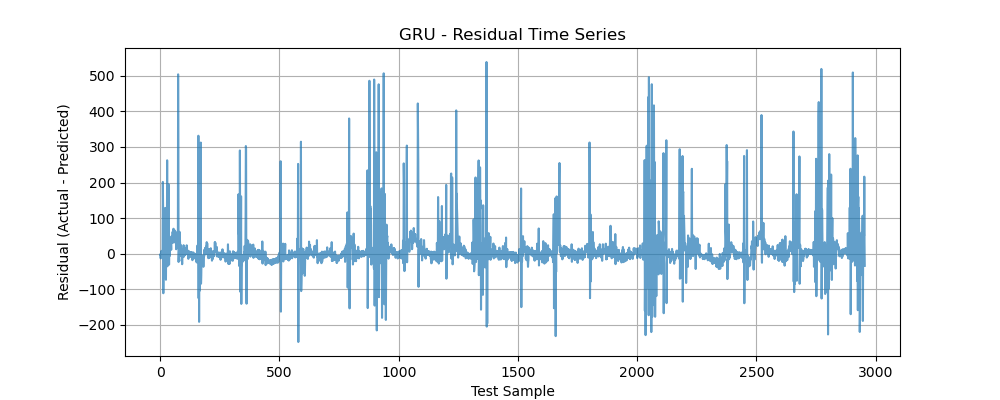

# Appliance Energy Forecasting: One-Step-Ahead Prediction from Time-Series Data

**One-line summary:** A causal one-step-ahead forecasting study on the UCI Appliances Energy dataset comparing persistence/seasonal baselines, gradient boosting, and a GRU sequence model.

## 1. Problem and Motivation

Buildings consume a large share of electricity, and even short-horizon forecasts can help with demand-side management, scheduling, and detecting unusual consumption. This project asks: given the last 6 hours of appliance energy use and concurrent indoor/outdoor sensor readings, can we predict appliance energy for the next 10-minute interval?

The challenge is that household energy use is **bursty and behavior-driven** (appliances switch on/off irregularly), while weather and indoor conditions explain only part of that variation. A useful forecasting system must therefore be evaluated against strong simple baselines and must avoid using any future information.

## 2. Background (Physics/Math in Plain Language)

We treat appliance energy as a time series sampled every 10 minutes. Let $y_k$ be the appliance energy at time step $k$, and let $z_k$ be a vector of other measurements available at the same time (temperatures, humidity, weather, lights, and time-of-day features).

The model learns a rule that looks at a recent history window and produces a prediction for the next step:

$$
\hat{y}_{k+1} = f_\theta\!\left(y_k, y_{k-1}, \ldots, y_{k-L+1},\; z_k, z_{k-1}, \ldots, z_{k-L+1}\right)
$$

- **$L=36$** means the model sees the previous 36 samples = 6 hours of history.
- **Causal** means inputs come only from time $\le k$; the target is $y_{k+1}$ and is never fed as an input.

**Why cyclic time features?** Human routines follow daily and weekly cycles. Encoding hour/day as plain numbers creates an artificial jump (23 → 0). Sine/cosine encodings place time on a circle so nearby times stay nearby:

$$
\text{hour\_sin}=\sin\!\left(\frac{2\pi h}{24}\right),\quad \text{hour\_cos}=\cos\!\left(\frac{2\pi h}{24}\right),\quad
\text{dow\_sin}=\sin\!\left(\frac{2\pi d}{7}\right),\quad \text{dow\_cos}=\cos\!\left(\frac{2\pi d}{7}\right)
$$

**How models differ (intuition):**
- **Persistence** assumes “next = now” — often strong for slow-changing signals.
- **Seasonal naïve** assumes “next = same time yesterday” — good when daily patterns repeat exactly.
- **Gradient boosting** learns decision rules over many engineered lag/features (nonlinear but tabular).
- **GRU** is a recurrent neural network that maintains a hidden state summarizing recent history, which can capture temporal patterns without manually specifying every interaction.

## 3. Data and Setup

- **Dataset:** UCI Appliances Energy Prediction dataset (`data/energydata_complete.csv`)
- **Sampling interval:** 10 minutes
- **Observations:** ~19,735
- **Target:** `Appliances` (Wh per 10-minute interval)
- **Exogenous variables used:** `lights`, `T1`–`T9`, `RH_1`–`RH_9`, `T_out`, `Press_mm_hg`, `RH_out`, `Windspeed`, `Visibility`, `Tdewpoint`, plus cyclic time features
- **Excluded variables:** `rv1`, `rv2` (random variables, not meaningful predictors)
- **History window:** $L=36$ (6 hours)
- **Train/validation/test split:** Chronological 70% / 15% / 15% (no shuffling)
- **Leakage prevention:** transformations fit on training data only; each supervised sample’s split is determined by the timestamp of its target $y_{k+1}$

**Pipeline entry point:** `main.py` → `src.main:main`  
**Core stages:** `load_data` → `engineer_features` → baseline/GB/GRU training → evaluation → plots and saved artifacts (`src/data_loader.py`, `src/feature_engineering.py`, `src/baselines.py`, `src/gradient_boosting.py`, `src/gru_model.py`, `src/evaluation.py`, `src/plotting.py`).

## 4. Methods

| Model | Type | Definition / implementation notes |
|---|---|---|
| Persistence | Baseline | $\hat{y}_{k+1}=y_k$; uses previous observed appliance value |
| Seasonal naïve | Baseline | $\hat{y}_{k+1}=y_{k-144}$ (24 h × 6 samples/h = 144) |
| Gradient Boosting | Nonlinear tabular ML | `HistGradientBoostingRegressor` trained on flattened lagged/engineered features; validated on holdout split |
| GRU | Recurrent neural network | PyTorch sequence model over inputs shaped `[batch, 36, features]`; trained for 10 epochs in the reported run |

**Metrics reported:** MAE, RMSE, $R^2$, Bias, and MASE (MAE relative to persistence baseline), computed on the test set:

$$
\mathrm{MAE}=\frac{1}{N}\sum_{k=1}^{N}\left|y_k-\hat{y}_k\right|,\quad
\mathrm{RMSE}=\sqrt{\frac{1}{N}\sum_{k=1}^{N}\left(y_k-\hat{y}_k\right)^2},\quad
R^2 = 1 - \frac{\sum_{k=1}^{N}(y_k-\hat{y}_k)^2}{\sum_{k=1}^{N}(y_k-\bar{y})^2}
$$

$$
\mathrm{MASE}=\frac{\mathrm{MAE}_{\text{model}}}{\mathrm{MAE}_{\text{persistence}}},\quad
\mathrm{Bias}=\frac{1}{N}\sum_{k=1}^{N}(\hat{y}_k-y_k)
$$

## 5. Results and Analysis

### Test-set metrics

Source: `outputs/metrics/final_metrics.json`

| Model | MAE (Wh) ↓ | RMSE (Wh) ↓ | $R^2$ ↑ | Bias (Wh) | MASE (vs persistence, MAE) ↓ |
|---|---:|---:|---:|---:|---:|
| Persistence | **26.789** | 66.904 | 0.459 | -0.129 | 1.000 |
| Seasonal naïve | 50.508 | 107.747 | -0.404 | -1.729 | 1.885 |
| Gradient Boosting | 33.635 | **62.142** | **0.533** | 14.320 | 1.256 |
| GRU | 29.773 | 65.067 | 0.488 | -12.448 | 1.111 |

### Interpretation

- **Persistence is hardest to beat on MAE at 10-minute horizon.** Appliance demand changes slowly most of the time, so “next equals now” is a strong short-term guess. All learned models have MASE > 1 on MAE in this run, meaning they did not reduce average absolute error below persistence.
- **Gradient Boosting performs best on RMSE and $R^2$.** Squared-error metrics penalize large misses more heavily; GB’s lower RMSE and higher $R^2$ suggest it better limits big errors by using nonlinear interactions between lagged demand, environment, and time features.
- **GRU is competitive but behind GB in this configuration.** GRU improves over persistence on RMSE/$R^2$ (65.07 vs 66.90; 0.488 vs 0.459) but shows a negative bias (-12.45 Wh), indicating underprediction on average over the test period.
- **Seasonal naïve fails for this signal.** A fixed 24-hour lag ($R^2 = -0.404$) is too rigid because day-to-day appliance usage does not repeat deterministically at 10-minute resolution.
- **What $R^2 \approx 0.53$ means here.** For behavior-driven energy data, moderate variance explained can still be valuable; unpredictable human actions create an irreducible error floor that no purely data-driven one-step model can remove.

### Figures (from experiment outputs)

**Gradient Boosting — forecast**  

**Gradient Boosting — residuals**  

**GRU — forecast**  

**GRU — residuals**  

*Additional diagnostics (e.g. residual autocorrelation, hour-of-day error breakdown, peak-event analysis) can be added if regenerated/available in `outputs/figures/`.*

## 6. Limitations and Lessons

- **One-step horizon bias:** Models can over-rely on the most recent lag ($y_k$), approaching persistence-like behavior; multi-step or probabilistic forecasts are needed for planning horizons.
- **Error trade-offs:** Best MAE, RMSE, and $R^2$ came from different models here; model selection should match the operational cost of errors (average error vs large spikes).
- **Bias and calibration:** GB overpredicted on average (+14.32 Wh) while GRU underpredicted (-12.45 Wh), suggesting room for calibration or loss/objective tuning.
- **Feature/architecture scope:** Results reflect the current pipeline (e.g. GRU trained for 10 epochs); more tuning, regularization, or feature ablations could change rankings.
- **Strict causality is non-negotiable:** Chronological splitting and causal windows are required for realistic evaluation; random splits would leak temporal structure and inflate scores.

## 7. Tech Stack and Repo Link

- **Language:** Python 3
- **Libraries (as used in code):** NumPy, pandas, scikit-learn, PyTorch, joblib, matplotlib (plotting utilities)
- **Run:** `cd appliance_energy_forecasting && python3 main.py` (or `python3 -m src.main`)
- **Tests:** `cd appliance_energy_forecasting && python3 -m pytest -q`
- **Key outputs:** `outputs/metrics/final_metrics.json`, `outputs/predictions/test_predictions.csv`, `outputs/models/`, `outputs/figures/`, `outputs/report.md`
- **Repository:** local workspace project folder `appliance_energy_forecasting/` (add remote GitHub URL here if/when published)
