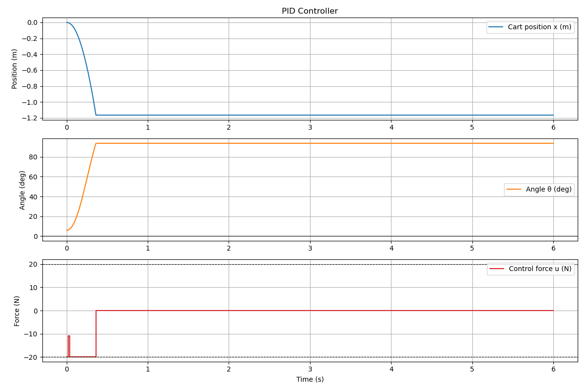
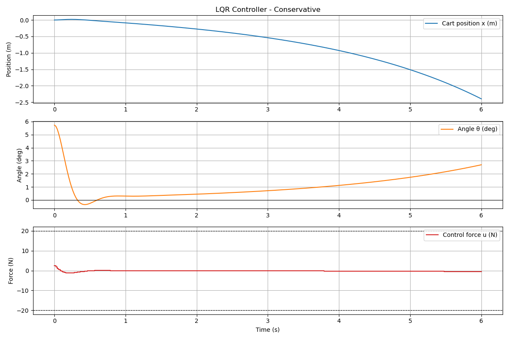
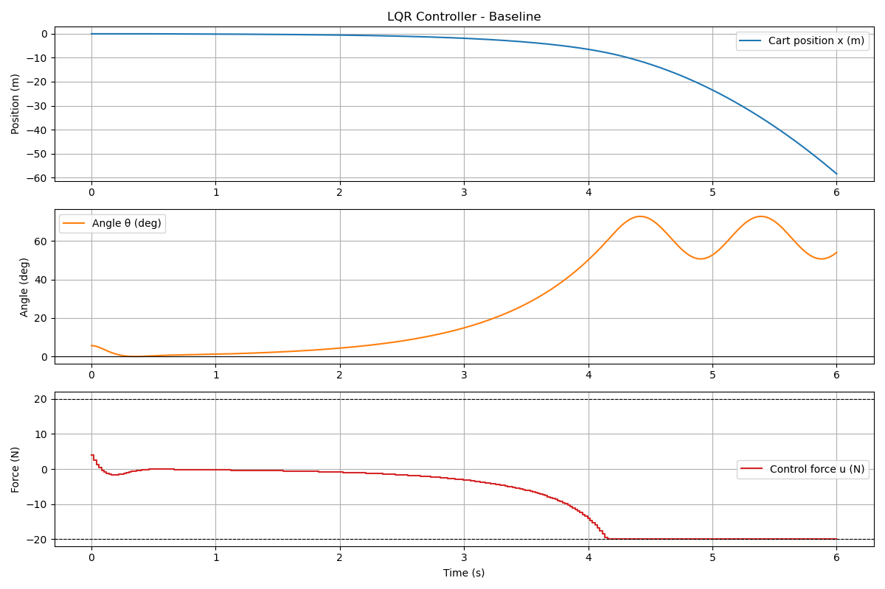
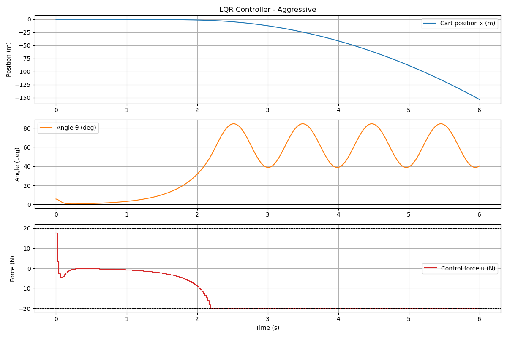
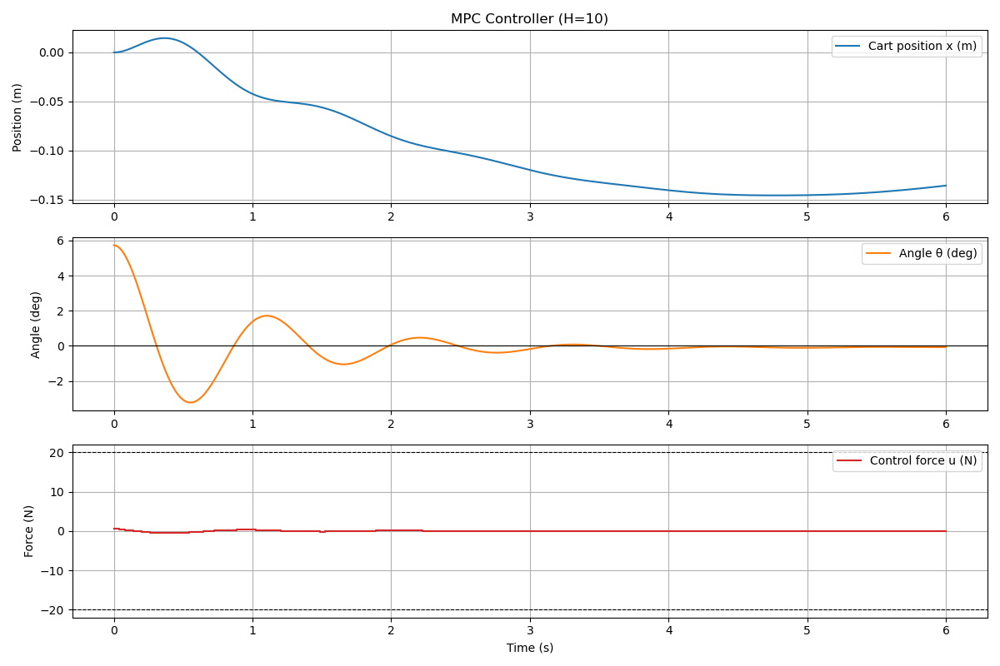
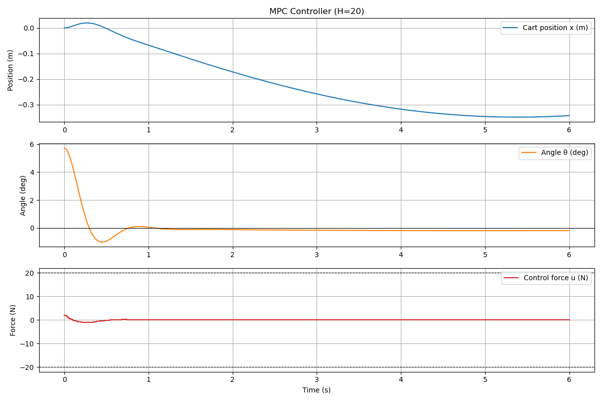
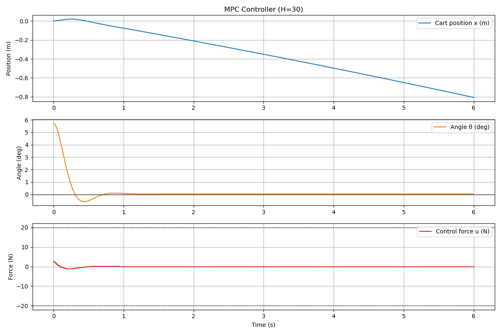
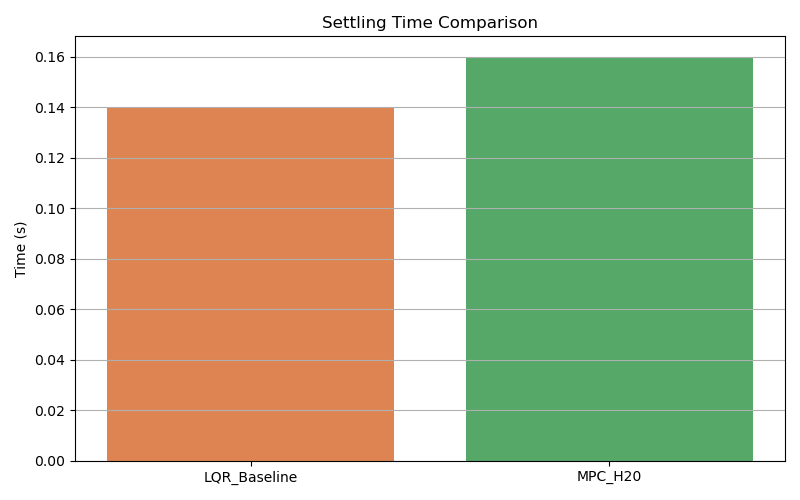
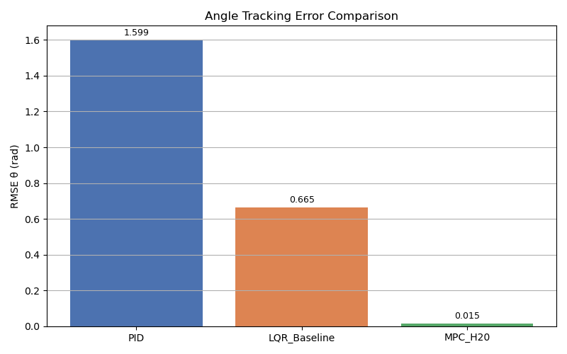
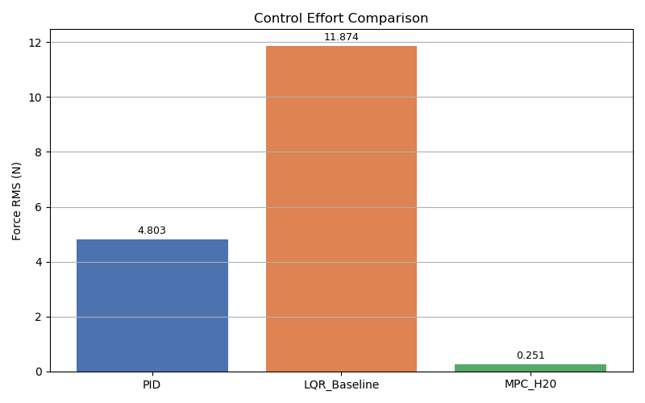

# Cart-Pole Control: Stabilizing an Inverted Pendulum with PID, LQR, and MPC

**One-line summary:** A nonlinear cart-pole simulation study comparing PID, LQR, and MPC for upright stabilization under actuator saturation, using performance metrics and response plots from controlled experiments.

## 1. Problem and Motivation

The cart-pole (inverted pendulum on a cart) is a classic unstable system: small deviations from upright grow rapidly unless corrected by control action. It is a benchmark for robotics, balance control, and safety-critical actuation because it combines **instability**, **underactuation** (one input force controls both cart motion and pole angle), and **constraints** (limited actuator force).

The goal is to stabilize the pole near upright ($\theta \to 0$) while keeping the cart position bounded ($x \to 0$), starting from a tilted initial condition, and to understand how controller structure and constraints affect real behavior.

## 2. Background (Physics/Math in Plain Language)

**State:** $x_s = [x,\ \dot{x},\ \theta,\ \dot{\theta}]^\top$ where $x$ is cart position and $\theta$ is pole angle from upright.

**Why it’s unstable:** In the linearized upright model, one eigenvalue is positive ($\lambda \approx +4.65$), meaning disturbances grow exponentially ($\sim e^{4.65t}$) without feedback—so delay, weak actuation, or poor control logic quickly leads to failure.

**Nonlinear dynamics (implemented):** with saturated control force $u$,

$$
\ddot{x} = \frac{u + m_p\sin\theta\,(l\dot{\theta}^2 + g\cos\theta)}{M + m_p\sin^2\theta}, \qquad
\ddot{\theta} = \frac{-u\cos\theta - m_p l\dot{\theta}^2\sin\theta\cos\theta - (M+m_p)g\sin\theta}{l\,(M + m_p\sin^2\theta)}
$$

**Linearization (for design):** around $(x_s^*,u^*)=(0,0)$, $\delta\dot{x}_s = A\delta x_s + B\delta u$, enabling controllability analysis and linear controller synthesis.

**Controller intuition:**
- **PID (on angle):** reacts to angle error now/past/rate of change; simple but single-output-focused and unaware of full system constraints/coupling.
- **LQR:** optimal full-state feedback $u=-Kx_s$ balancing state error and control effort via weights $(Q,R)$; assumes linear model and does not inherently enforce hard input limits.
- **MPC:** repeatedly solves a short-horizon optimization using a model, can include explicit constraints (e.g. $|u|\le 20$ N), and applies only the first action before replanning.

## 3. Data and Setup

- **System parameters:** $M=1.0$ kg (cart), $m_p=0.1$ kg (pole), $l=0.5$ m, $g=9.81$ m/s²
- **Initial condition:** $x(0)=0$, $\dot{x}(0)=0$, $\theta(0)=0.10$ rad, $\dot{\theta}(0)=0$
- **Simulation horizon:** $T=6$ s, sample time $T_s=0.02$ s (as used in experiment setup)
- **Actuator limit:** $|u(t)| \le 20$ N (saturation enforced)
- **Open-loop/structural checks (reported):** eigenvalues include unstable mode; controllability rank $=4$ (fully controllable)
- **Code entry point:** `main.py` (runs simulations, metrics, plots)

*Note:* The prompt/spec in project materials also describes noisy-measurement/Monte Carlo studies; the saved quantitative results summarized below correspond to the deterministic controller comparison artifacts present in `results/`.

## 4. Methods

| Controller | Implementation | Key idea / settings (from repo/results) |
|---|---|---|
| PID | `src/pid_controller.py` | Angle-feedback PID with saturation; reported run failed to stabilize closed-loop behavior |
| LQR (Conservative/Baseline/Aggressive) | `src/lqr_controller.py`, `src/cart_pole_dynamics.py` | $u=-Kx_s$, $K$ from CARE on linearized model with different $(Q,R)$ trade-offs |
| MPC ($H=10,20,30$) | `src/mpc_controller.py` | Receding-horizon constrained optimization on discretized linear model; horizons compared |

**Supporting modules:** `src/simulation.py` (rollouts), `src/metrics.py` (settling time, RMSE, RMS force, saturation, failure), `src/plotting.py`.

**Primary metrics (saved):** settling time, max $|\theta|$, max $|x|$, max/RMS force, saturation %, RMSE of $\theta$, failure flag (`|theta|` large / divergence condition).

## 5. Results and Analysis

### Quantitative comparison

Source: `results/metrics_summary.json`, `results/controller_comparison.csv`, `results/report.md`

| Controller | Settling time (s) | RMSE $\theta$ (rad) ↓ | RMS force (N) | Max |force| (N) | Saturation (%) | Max |x| (m) | Failed |
|---|---:|---:|---:|---:|---:|---:|:---:|
| PID | ∞ | 1.599 | 4.803 | 20.0 | 5.7 | 1.165 | **Yes** |
| LQR Conservative | 0.16 | 0.025 | 0.364 | 2.548 | **0.0** | 2.398 | No |
| LQR Baseline | 0.14 | 0.665 | 11.874 | 20.0 | 31.0 | 58.479 | No |
| LQR Aggressive | ∞ | 0.909 | 16.238 | 20.0 | 63.7 | 153.464 | No |
| MPC $H=10$ | 0.64 | 0.022 | 0.145 | 0.582 | **0.0** | 0.146 | No |
| MPC $H=20$ | **0.16** | 0.015 | 0.251 | 1.949 | **0.0** | 0.349 | No |
| MPC $H=30$ | **0.16** | **0.014** | 0.279 | 2.436 | **0.0** | 0.806 | No |

### Interpretation

- **PID failed for this MIMO stabilization task.** It regulates pole angle but does not explicitly control cart position; cart drift and nonlinear effects lead to divergence/failure despite modest average force.
- **LQR tuning exposes the effort–constraint trade-off.** Conservative tuning stabilizes gently with zero saturation and low RMSE. Baseline/aggressive tunings demand larger actions, hit the 20 N limit frequently (31% / 64%), and produce poor overall behavior (large cart excursions; aggressive never settles by the reported criterion).
- **MPC gives the best angle tracking with feasible inputs.** For $H\ge 20$, settling is fast (0.16 s) with the lowest RMSE $\theta$ and no saturation, because the optimizer plans over future dynamics while respecting constraints.
- **Horizon matters:** $H=10$ is feasible but slower to settle (0.64 s); longer horizons improve coordinated cart–pole regulation in this setup.

### Figures (experiment outputs)

**PID response**  

**LQR responses**  

**MPC responses**  

**Comparisons**  

## 6. Limitations and Lessons

- **Model dependence:** LQR/MPC designs rely on a linearized (and discretized, for MPC) model; performance can degrade far from upright or under unmodeled dynamics.
- **Saturation breaks linear optimality assumptions:** High-gain LQR can request infeasible forces; clipping is not the same as constraint-aware optimal control.
- **Single-scenario evidence:** Saved metrics shown are for one nominal setup; robustness claims would be stronger with systematic noise/disturbance Monte Carlo sweeps (as outlined in project specs) and explicit failure-rate statistics.
- **PID scope:** PID may work for angle-only subproblems, but full cart-pole stabilization generally requires multi-state feedback or additional loops/logic.
- **Practical deployment:** Real hardware needs state estimation (observer/Kalman filter), delay/quantization handling, and safety constraints beyond those modeled here.

## 7. Tech Stack and Repo Link

- **Language:** Python 3
- **Libraries (from implementation):** NumPy, SciPy (e.g. CARE for LQR), Matplotlib, CSV/JSON utilities
- **Run:** `cd cart_pole_control && python3 main.py`
- **Tests:** `cd cart_pole_control && python3 -m pytest -q`
- **Key outputs:** `results/metrics_summary.json`, `results/controller_comparison.csv`, `results/figures/`, `results/report.md`
- **Repository:** local workspace project folder `cart_pole_control/` (add remote GitHub URL here if/when published)
