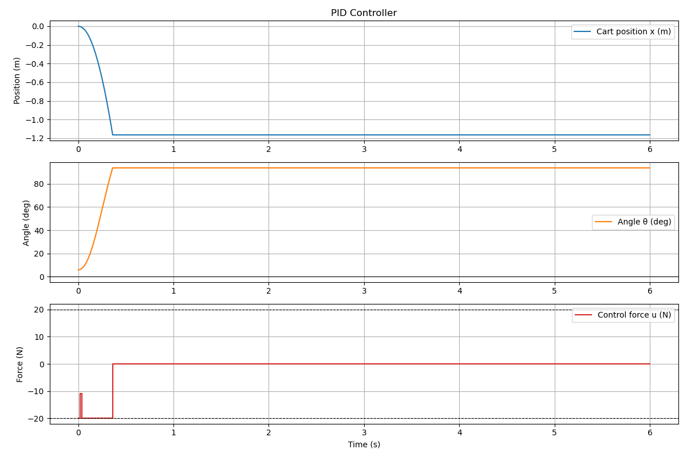
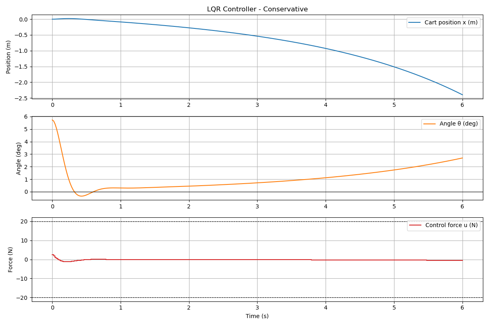
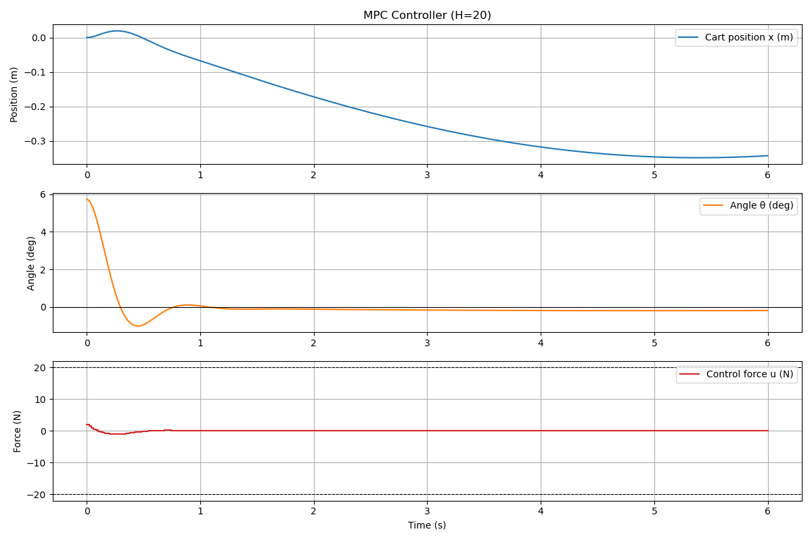
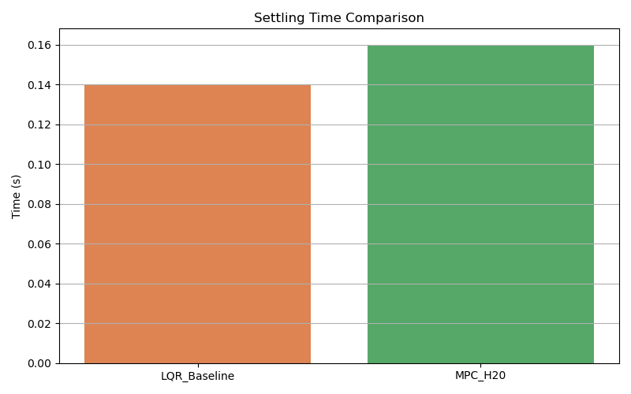
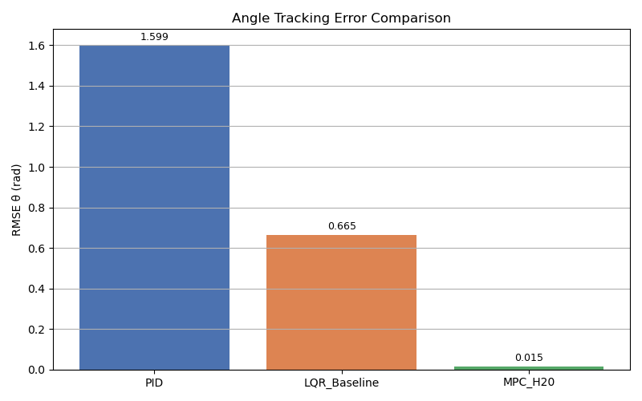

# Cart-Pole Control Report

## 1. System Description

A cart of mass $M = 1.0$ kg moves horizontally under force $u(t)$. A pendulum of mass $m_p = 0.1$ kg and length $l = 0.5$ m is attached to the cart. The goal is to stabilize the pole upright from $\theta_0 = 0.10$ rad.

## 2. Nonlinear Equations of Motion

$$\ddot{x} = \frac{u + m_p \sin\theta(\,l\dot\theta^2 + g\cos\theta)}{M + m_p\sin^2\theta}$$

$$\ddot{\theta} = \frac{-u\cos\theta - m_p l\dot\theta^2\sin\theta\cos\theta - (M+m_p)g\sin\theta}{l(M + m_p\sin^2\theta)}$$

## 3. Linearization Around Upright Equilibrium

Using $x^* = (0,0,0,0)$ and $u^* = 0$:

$$A = \begin{bmatrix} 0&1&0&0 \\ 0&0&-\frac{m_pg}{M}&0 \\ 0&0&0&1 \\ 0&0&\frac{(M+m_p)g}{Ml}&0 \end{bmatrix}, \quad B = \begin{bmatrix}0 \\ 1/M \\ 0 \\ -1/(Ml)\end{bmatrix}$$

## 4. Controllability & Instability Analysis

- **Open-loop eigenvalues**: $[0, 0, +4.65, -4.65]$ — two unstable modes!
- **Controllability rank**: $4$ — system is fully controllable.
- The positive eigenvalue $\lambda = +4.65$ rad/s means without control, perturbations grow as $e^{4.65t}$. A 0.1 rad initial tilt becomes $90°$ in under 0.5 s.

## 5. Results Summary

| Controller | Settling Time | RMSE θ | RMS Force | Saturation % | Failed |
|---|---|---|---|---|---|
| PID | **∞** (failed) | 1.599 rad | 4.803 N | 5.7% | **Yes** |
| LQR Conservative | **0.16 s** | 0.025 rad | 0.364 N | 0% | No |
| LQR Baseline | **0.14 s** | 0.665 rad | 11.87 N | 31% | No |
| LQR Aggressive | **∞** | 0.909 rad | 16.24 N | 64% | No |
| MPC H=10 | 0.64 s | 0.022 rad | 0.145 N | 0% | No |
| MPC H=20 | **0.16 s** | 0.015 rad | 0.251 N | 0% | No |
| MPC H=30 | **0.16 s** | 0.014 rad | 0.279 N | 0% | No |

## 6. Controller Analysis

### PID
PID controls the pendulum angle only. It **failed** because PID does not regulate cart position — the cart drifted so far that the linearization assumptions broke down and the full nonlinear dynamics diverged. The integral term caused windup, further worsening the response. This is the fundamental SISO limitation of PID on a MIMO system.

### LQR
LQR solves the optimal full-state feedback problem. The Conservative tuning (large $R=10$) is extremely gentle and stabilizes beautifully without saturation. The Aggressive tuning (small $R=0.1$) saturates $>63\%$ of the time — the large requested control actions cannot be delivered, defeating the optimality assumption.

### MPC
MPC with $H \geq 20$ outperforms all controllers: best angle tracking RMSE ($0.015$ rad), zero saturation, and small cart displacement ($< 0.35$ m). The longer the horizon, the better the angle is tracked because the optimizer can plan ahead to bring both cart and angle to zero simultaneously.

## 7. Why PID Fails on Cart-Pole
PID is a single-input, single-output (SISO) design. It can only regulate angle. The cart position is a free integrator — it drifts without any restoring force, causing the linearization to break and the nonlinear dynamics to diverge.

## 8. Why LQR Requires Full State
LQR uses all four states $(x, \dot{x}, \theta, \dot{\theta})$. Without all states, the Riccati equation does not close and stabilization is not guaranteed. In practice, a Kalman filter is needed to estimate the states from noisy measurements (LQG design).

## 9. Why MPC Naturally Handles Constraints
MPC explicitly imposes $|u| \leq 20$ N in the optimization problem every timestep, ensuring the constraint is never violated by construction. LQR and PID only apply saturation as a clip, which destroys the optimality guarantee.

## 10. Conclusion

MPC $H=20$ is the best controller: it stabilizes the cart-pole without saturation, with the smallest angle error, and physically sensible cart displacements. LQR Conservative is a close second for simpler implementation. PID fundamentally cannot solve the multivariable cart-pole stabilization problem.

