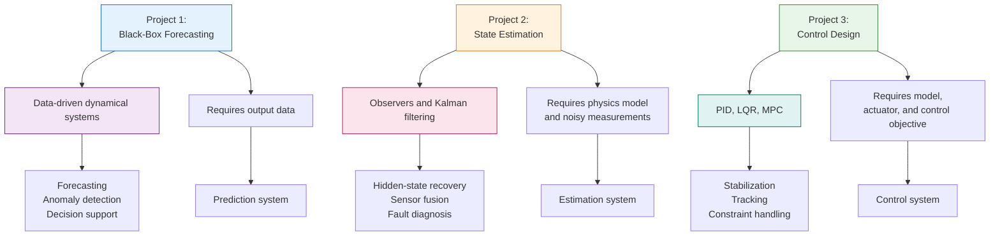
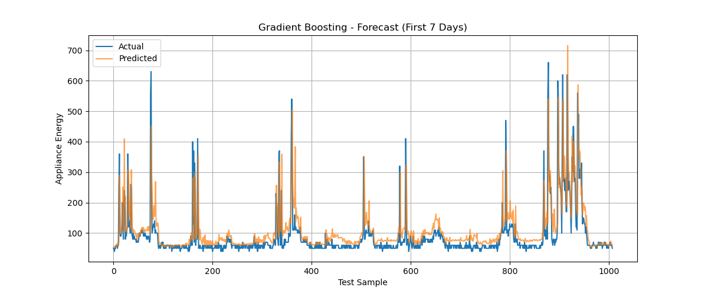
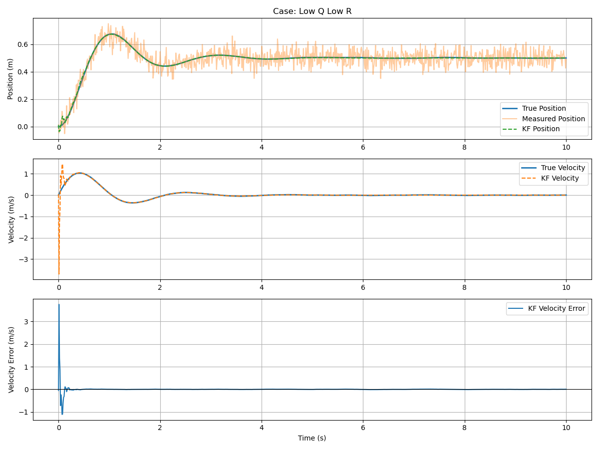
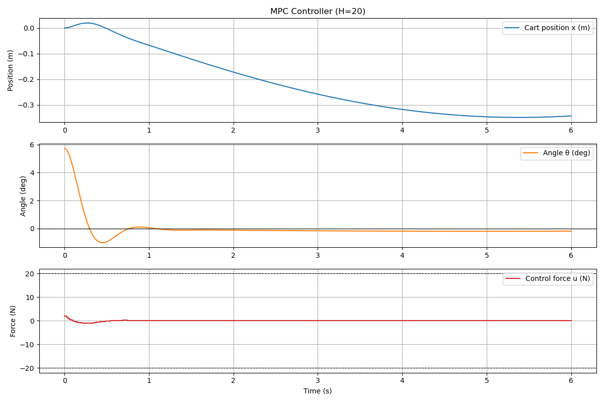
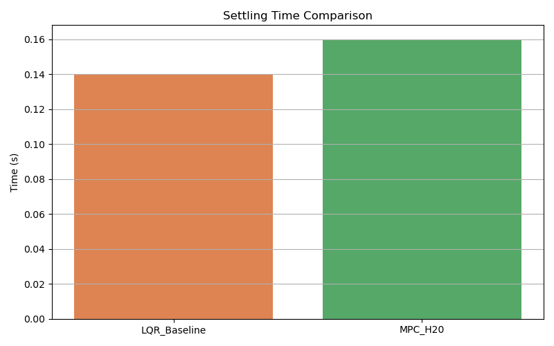

# Data Driven **Modeling Systems**:

1. **Black-box data-driven forecasting**
2. **State estimation from noisy measurements**
3. **Feedback control under real-world constraints**

Each project must be implemented from scratch in Python, with reproducible code, quantitative validation, residual/error analysis, figures, and a written report.

# How These Projects Connect

These three projects complete the essential **Data-Driven Modeling Systems** workflow:

$$
\text{Data} \rightarrow \text{Model} \rightarrow \text{Estimation} \rightarrow \text{Dynamics} \rightarrow \text{Control} \rightarrow \text{Deployment}
$$

---

## Project 1: UCI Appliances Energy Forecasting

**Core concept:** Black-box one-step-ahead forecasting from time-series data.

We built a complete causal forecasting pipeline for the UCI Appliances Energy dataset (~19,735 observations at 10-minute intervals). The fundamental problem is:

$$
\hat{y}_{k+1} = f_\theta(y_k, y_{k-1}, \ldots, y_{k-L+1},\ z_k, \ldots, z_{k-L+1})
$$

where $y_k$ is appliance energy and $z_k$ contains 26 exogenous variables (room temperatures, humidity, outdoor weather). We enforced a strict **chronological 70/15/15 split** — no future information ever leaks into the input window.

### Cyclic Time Encoding

Human behavior has daily and weekly periodicity. We encoded time as smooth continuous signals:

$$
\text{hour\_sin} = \sin\!\left(\frac{2\pi h}{24}\right), \quad \text{hour\_cos} = \cos\!\left(\frac{2\pi h}{24}\right)
$$

### GRU Architecture

The recurrent model maintains a learned hidden state:

$$
h_k = \Phi_\theta(h_{k-1},\ \xi_k), \quad \hat{y}_{k+1} = \Psi_\theta(h_k)
$$

The GRU hidden state $h_k$ is a black-box latent state — it has no physical interpretation but captures temporal dependencies automatically.

### Final Metrics (Test Set)

| Model             | MAE (Wh)        | RMSE (Wh) | $R^2$         | MASE  |
| ----------------- | --------------- | --------- | --------------- | ----- |
| Persistence       | 26.79           | 66.90     | 0.459           | 1.000 |
| Seasonal Naïve   | 50.51           | 107.75    | −0.404         | 1.885 |
| Gradient Boosting | 33.64           | 62.14     | **0.533** | 1.256 |
| GRU               | **29.77** | 65.07     | 0.488           | 1.111 |

**Key finding:** Persistence is deceptively hard to beat on MAE because household energy is bursty. Advanced models win on RMSE and $R^2$ by avoiding large misses during peak events. An $R^2 \approx 0.53$ is strong for human behavioral data — irreducible randomness (flipping a light switch) limits any model.

---

## Project 2: Mass-Spring-Damper State Estimation

**Core concept:** Recovering unmeasured velocity from noisy position observations using a physics-based filter.

The physical system is $m\ddot{x} + c\dot{x} + kx = u(t)$ with $m=2$, $c=4$, $k=20$. In state-space form:

$$
A = \begin{bmatrix}0&1\\-10&-2\end{bmatrix},\quad B = \begin{bmatrix}0\\0.5\end{bmatrix},\quad C = \begin{bmatrix}1&0\end{bmatrix}
$$

### Observability

The observability matrix:

$$
\mathcal{O} = \begin{bmatrix}C \\ CA\end{bmatrix} = \begin{bmatrix}1&0\\0&1\end{bmatrix}, \quad \text{rank}(\mathcal{O}) = 2 = n \implies \text{fully observable}
$$

This proves velocity can be reconstructed from position measurements alone.

### Discrete Kalman Filter (ZOH discretization at $T_s = 0.01$ s)

**Predict:** $\hat{x}_{k|k-1} = A_d\hat{x}_{k-1} + B_d u$, $\quad P_{k|k-1} = A_d P A_d^T + Q$

**Update:** $K_k = P_{k|k-1}C^T(CP_{k|k-1}C^T + R)^{-1}$, $\quad \hat{x}_{k|k} = \hat{x}_{k|k-1} + K_k(y_k - C\hat{x}_{k|k-1})$

The Kalman gain $K_k$ balances model trust ($Q$) vs sensor trust ($R$): as $R \to 0$ trust measurements; as $Q \to 0$ trust the model.

### Results Across Noise Cases

| Case                                     | KF Velocity RMSE    | KF Velocity MAE     | Convergence Time |
| ---------------------------------------- | ------------------- | ------------------- | ---------------- |
| Low$Q$, Low $R$ (ideal)              | **0.144 m/s** | **0.016 m/s** | **0.22 s** |
| Low$Q$, High $R$ (poor sensor)       | 0.388 m/s           | 0.056 m/s           | 1.68 s           |
| High$Q$, Low $R$ (model uncertainty) | 0.349 m/s           | 0.254 m/s           | ∞               |
| High$Q$, High $R$ (realistic)        | 0.582 m/s           | 0.364 m/s           | ∞               |

**Key finding:** With correct noise covariance specification, the Kalman filter converges in 0.22 s with negligible velocity error. High process noise ($Q$) is the harder problem — the filter cannot trust its own predictions and must rely on the noisy sensor, preventing steady-state convergence.

---

## Project 3: Cart-Pole Control — PID, LQR, MPC

**Core concept:** Stabilizing an inherently unstable nonlinear system under actuator saturation.

The nonlinear cart-pole equations:

$$
\ddot{x} = \frac{u + m_p\sin\theta(l\dot\theta^2 + g\cos\theta)}{M + m_p\sin^2\theta}
$$

$$
\ddot\theta = \frac{-u\cos\theta - m_p l\dot\theta^2\sin\theta\cos\theta - (M+m_p)g\sin\theta}{l(M + m_p\sin^2\theta)}
$$

### Why the Cart-Pole is Unstable

The linearized open-loop eigenvalues are $[0, 0, +4.65, -4.65]$. The unstable pole $\lambda = +4.65$ means perturbations grow as $e^{4.65t}$ — a $0.10$ rad tilt becomes $90°$ in under 0.5 s without control.

### LQR Design

Solves the continuous algebraic Riccati equation $A^TP + PA - PBR^{-1}B^TP + Q = 0$ for gain $K = R^{-1}B^TP$, placing closed-loop eigenvalues in the left-half plane.

### MPC Formulation

At each time step, solve:

$$
\min_{u_0,\ldots,u_{H-1}} \sum_{j=1}^{H} x_j^TQx_j + \sum_{j=0}^{H-1}u_j^TRu_j \quad \text{s.t.}\; x_{j+1} = A_dx_j + B_du_j,\; |u_j| \leq 20 \text{ N}
$$

Apply only $u_0^*$, then re-solve at the next step (receding horizon).

### Final Comparison ($\theta_0 = 0.10$ rad, $T = 6$ s)

| Controller       | Settling Time    | RMSE$\theta$      | RMS Force | Saturation % | Failed?          |
| ---------------- | ---------------- | ------------------- | --------- | ------------ | ---------------- |
| PID              | ∞               | 1.599 rad           | 4.80 N    | 5.7%         | **Yes** ❌ |
| LQR Conservative | 0.16 s           | 0.025 rad           | 0.36 N    | 0%           | No ✅            |
| LQR Baseline     | 0.14 s           | 0.665 rad           | 11.87 N   | 31%          | No               |
| LQR Aggressive   | ∞               | 0.909 rad           | 16.24 N   | 64%          | No               |
| MPC$H=10$      | 0.64 s           | 0.022 rad           | 0.14 N    | 0%           | No ✅            |
| MPC$H=20$      | **0.16 s** | **0.015 rad** | 0.25 N    | **0%** | No ✅            |
| MPC$H=30$      | 0.16 s           | 0.014 rad           | 0.28 N    | 0%           | No ✅            |

**Key finding:** PID fails because it is a SISO controller on a MIMO system — it stabilizes angle but cannot regulate cart position, which drifts until the nonlinear dynamics diverge. LQR Aggressive over-saturates the actuator (64%), destroying its own optimality guarantee. **MPC $H=20$ is the clear winner**: best angle tracking, zero saturation, and small cart displacement — achieved by planning ahead over the prediction horizon.

---

## Conclusion

These three projects form a complete progression from **data** to **control**:

| Project                 | What You Learn                                | Mathematical Core                                                    |
| ----------------------- | --------------------------------------------- | -------------------------------------------------------------------- |
| 1 — Energy Forecasting | ML for time-series, causal splits, baselines  | $\hat{y}_{k+1} = f_\theta(\text{history})$                         |
| 2 — State Estimation   | Observability, Kalman filter, noise trade-off | $\hat{x}_{k\|k} = \hat{x}_{k\|k-1} + K_k(y_k - C\hat{x}_{k\|k-1})$ |
| 3 — Cart-Pole Control  | Stability, LQR, MPC, saturation effects       | $\min J = \int(x^TQx + u^TRu)\,dt$                                 |

Now we are fully equipped for **system identification, Kalman filtering, observers, PID/LQR/MPC control, and advanced data-driven dynamical modeling**.
