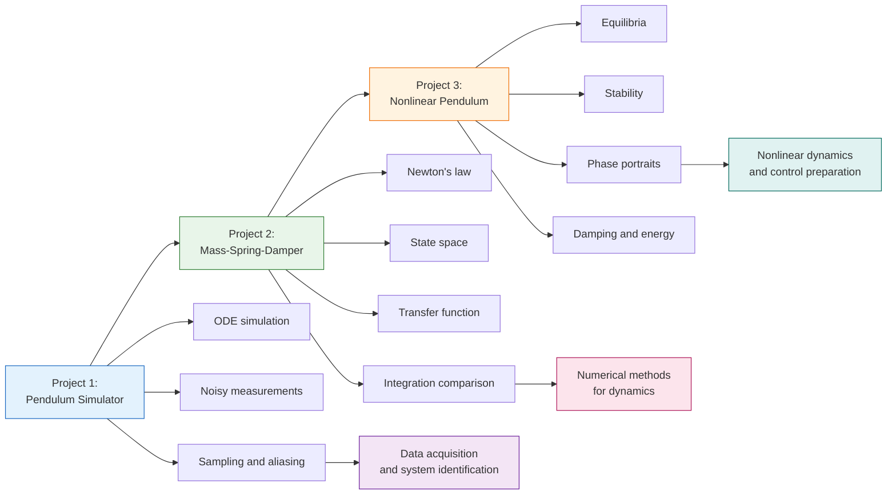

# How These Projects Connect

These three projects form the comprehensive foundation for **Modeling Systems** from first principles. Here is how they build upon each other:

### 1. Project 1: Pendulum Simulator
**Key Outcomes:** Simulation, measurement, sampling, and numerical error.
We started by defining a physical pendulum through Newton's equations $mL^2\ddot{\theta}+b\dot{\theta}+mgL\sin\theta=\tau(t)$. By casting this into a first-order state-space, we could implement numerical integrators. We learned that the choice of integrator heavily impacts stability and energy conservation, with RK4 drastically outperforming Explicit Euler. We also simulated digital measurements subject to Gaussian noise $v_k \sim \mathcal{N}(0, \sigma_\theta^2)$ and discovered the phenomenon of aliasing when the sampling period $T_s$ falls below the Nyquist rate.

### 2. Project 2: Mass-Spring-Damper
**Key Outcomes:** Derivation, linear state-space modeling, transfer functions, and integration accuracy.
Applying our simulation knowledge, we formalized linear dynamical systems using the mass-spring-damper model $m\ddot{x} + c\dot{x} + kx = u(t)$. This allowed us to mathematically derive the standard linear state-space model $\dot{x} = Ax + Bu$ and the transfer function $G(s) = \frac{1}{ms^2 + cs + k}$. By computing the poles of the transfer function, we could analytically prove stability and evaluate the exact step response for the underdamped case ($\zeta < 1$).

### 3. Project 3: Nonlinear Pendulum
**Key Outcomes:** Nonlinear dynamics, stability, phase portraits, energy, and damping.
Finally, we removed the small-angle linear approximation ($\sin \theta \approx \theta$) and dealt with the full nonlinear ODE. We computed the Jacobian matrix analytically to classify the isolated equilibria. For example, evaluating the Jacobian at $\theta = 0$ produced strictly stable eigenvalues for $b>0$, while evaluating at $\theta = \pi$ proved it was a saddle point (unstable). We visualized these dynamics using dense phase portraits, identifying closed orbits for energy-conserving undamped models and decaying spirals for dissipative models ($-\frac{dE}{dt} = b\dot{\theta}^2$).

**Conclusion:** 
After completing this sequence, you are fully equipped for system identification, Kalman filtering, observers, PID/LQR/MPC control, and advanced data-driven dynamical modeling. The first-principles mathematical derivations paired with numerical programming provide the absolute groundwork for real-world cyber-physical systems engineering.
