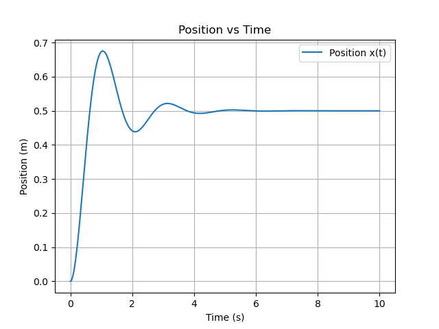
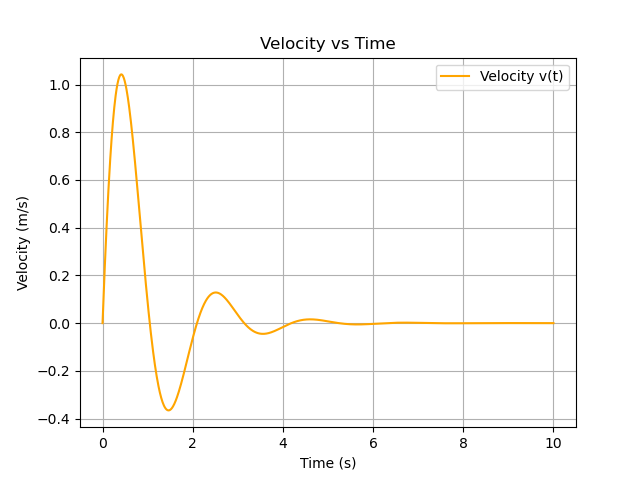
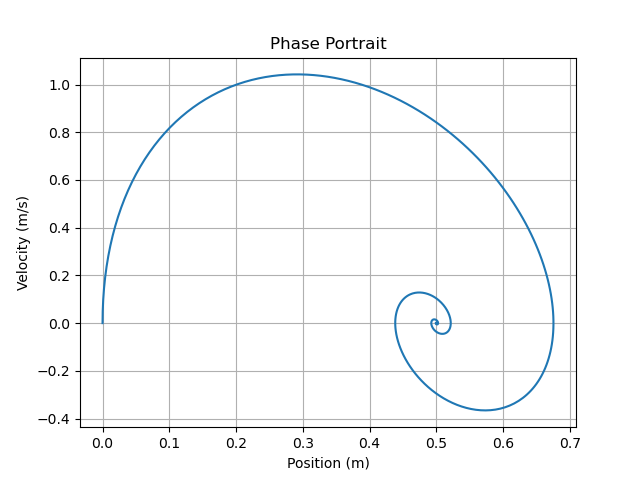
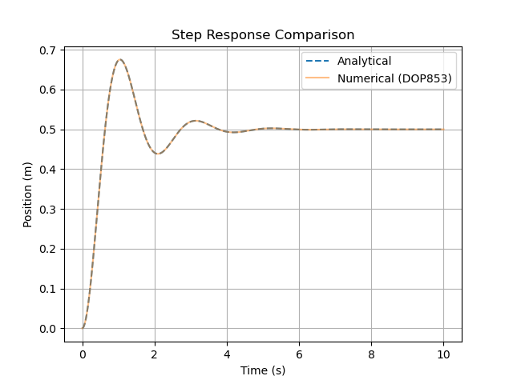
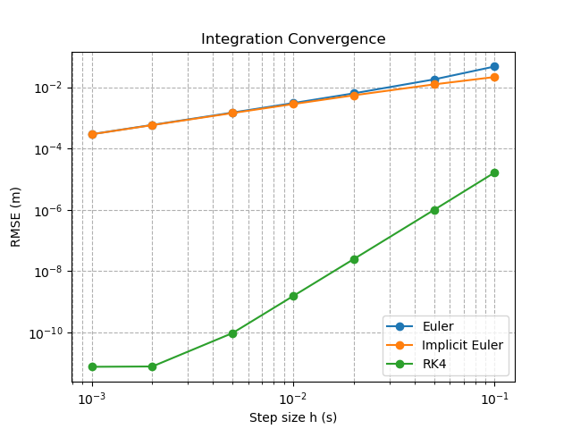
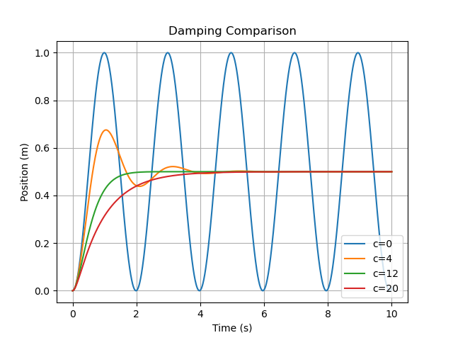
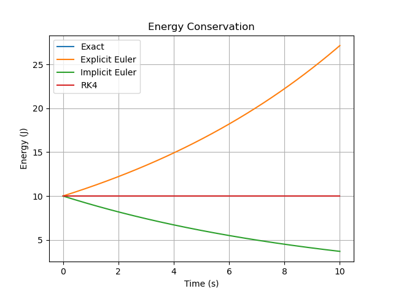

# Mass–Spring–Damper: From Newton’s Law to State Space, Transfer Functions, and Numerical Integration

**One-line summary:** A first-principles modeling and simulation study of a forced mass–spring–damper system, comparing analytical behavior with Euler, implicit Euler, and RK4 numerical integrators across step sizes and damping regimes.

## 1. Problem and Motivation

Mass–spring–damper systems are foundational models for vibration, vehicle suspension, structural dynamics, and many control problems. They are simple enough to derive and solve analytically in important cases, yet rich enough to expose key engineering trade-offs: modeling assumptions, stability, transient response, and numerical simulation accuracy.

This project builds the model from physics (Newton’s law), expresses it in forms used in control and simulation (state space and transfer function), and quantifies how numerical integration choices affect accuracy and qualitative behavior (including energy trends).

## 2. Background (Physics/Math in Plain Language)

**Physical model:** A mass $m$ attached to a spring (stiffness $k$) and damper (coefficient $c$) moves under external force $u(t)$:

$$
m\ddot{x} + c\dot{x} + kx = u(t)
$$

- Spring force pulls back toward equilibrium ($-kx$).
- Damping resists motion ($-c\dot{x}$), removing energy in real systems.

**State-space view:** define $x_1=x$ (position), $x_2=\dot{x}$ (velocity), giving $\dot{\mathbf{x}}=A\mathbf{x}+Bu$, $y=C\mathbf{x}$. This form is what simulators and many controllers use directly.

**Transfer-function view:** in Laplace domain (zero initial conditions), $G(s)=X(s)/U(s)=\frac{1}{ms^2+cs+k}$. Poles of $G(s)$ (equivalently eigenvalues of $A$) determine stability and oscillation/decay character.

**Damping ratio intuition:** $\zeta = \frac{c}{2\sqrt{mk}}$ indicates whether the step response oscillates ($\zeta<1$, underdamped), is critically damped ($\zeta=1$), or returns without oscillation ($\zeta>1$, overdamped). The natural frequency is $\omega_n=\sqrt{k/m}$.

## 3. Data and Setup

- **Parameters:** $m=2.0$ kg, $c=4.0$ N·s/m, $k=20.0$ N/m
- **Input:** unit-step-like force $u(t)=10$ N for $t\ge 0$
- **Initial conditions:** $x(0)=0$ m, $\dot{x}(0)=0$ m/s
- **Simulation window:** $t \in [0,10]$ s
- **Derived properties (reported):** $\omega_n\approx 3.162$ rad/s, $\zeta\approx 0.316$ (underdamped), poles $s=-1\pm 3j$ (stable), steady-state displacement $x_{ss}=u/k=0.5$ m
- **Reference solution:** high-accuracy SciPy/DOP853 solve used for numerical error comparisons (per implementation)
- **Step-size sweep (fixed-step methods):** $h \in \{0.1, 0.05, 0.02, 0.01, 0.005, 0.002, 0.001\}$ s

**Artifacts:** `results/simulation_truth.csv`, `results/integration_comparison.csv`, `results/damping_study.csv`, figures in `results/figures/`, summary in `results/report.md`.

## 4. Methods

| Component | Description | Repo location |
|---|---|---|
| Analytical/physical derivation | FBD, Newton’s law, steady-state and underdamped response | `src/dynamics.py`, report |
| State-space model | $A,B,C,D$ construction and simulation interface | `src/state_space.py` |
| Transfer-function analysis | $\omega_n,\zeta$, poles/stability characterization | `src/transfer_function.py` |
| Numerical integrators | Explicit Euler, implicit Euler, RK4, SciPy solvers | `src/integrators.py` |
| Error metrics | RMSE/MAE vs reference trajectory | `src/metrics.py` |
| Experiment driver | Runs studies and saves CSV/figures | `main.py` |

**Comparison design:** for each method and step size, compute position error against a high-accuracy reference over the same time grid/window (as exported to `integration_comparison.csv`).

## 5. Results and Analysis

### Analytical and stability results

- **ODE:** $2\ddot{x}+4\dot{x}+20x=u(t)$ (for given parameters)
- **State-space:** $A=\begin{bmatrix}0&1\\-10&-2\end{bmatrix}$, $B=\begin{bmatrix}0\\0.5\end{bmatrix}$, $C=[1\;0]$
- **Transfer function:** $G(s)=\frac{0.5}{s^2+2s+10}$
- **Behavior:** underdamped and stable; step response converges to $0.5$ m with decaying oscillations

### Numerical integration accuracy

Source: `results/integration_comparison.csv`

| Method | $h$ (s) | RMSE (position) | MAE (position) |
|---|---:|---:|---:|
| Euler | 0.100 | 4.752e-02 | 3.172e-02 |
| Implicit Euler | 0.100 | 2.155e-02 | 1.113e-02 |
| RK4 | 0.100 | 1.655e-05 | 9.442e-06 |
| Euler | 0.010 | 3.042e-03 | 1.729e-03 |
| Implicit Euler | 0.010 | 2.827e-03 | 1.573e-03 |
| RK4 | 0.010 | 1.539e-09 | 8.806e-10 |
| Euler | 0.001 | 2.942e-04 | 1.656e-04 |
| Implicit Euler | 0.001 | 2.921e-04 | 1.641e-04 |
| RK4 | 0.001 | 7.588e-12 | 2.776e-12 |

**Interpretation:**
- **Convergence rates match theory:** Euler methods show approximately first-order error reduction (error scales ~linearly with $h$), while RK4 shows fourth-order behavior (dramatically smaller errors as $h$ decreases) until near numerical precision limits.
- **Accuracy gap is large:** even at coarse steps RK4 is orders of magnitude more accurate for this smooth underdamped dynamics; Euler variants require very small $h$ for comparable accuracy.
- **Implicit vs explicit Euler:** implicit Euler is more accurate at large $h$ here and tends to introduce numerical damping in oscillatory settings (a stability/energy qualitative difference noted in the report).

### Damping and energy behavior (reported)

- Damping sweep ($c\in\{0,4,12,20\}$): $c=0$ undamped oscillation; $c=4$ underdamped decay; larger $c$ removes/limits oscillation (critical/overdamped regimes).
- Undamped energy ($u=0,c=0$): ideal energy conserved; explicit Euler tends to inject numerical energy, implicit Euler dissipates it, and RK4 tracks conservation much more closely over the simulated horizon.

### Figures (experiment outputs)

**Position and velocity responses**  

**Phase portrait**  

**Analytical vs numerical / convergence**  

**Damping and energy studies**  

## 6. Limitations and Lessons

- **Idealized physics:** linear spring/damper and no Coulomb friction, saturation, or backlash; real hardware deviates especially at large amplitudes or with contact effects.
- **Integrator choice is application-dependent:** RK4 is excellent for smooth non-stiff dynamics here, but stiff systems or long-horizon structure-preserving needs may require implicit/stiff or symplectic methods.
- **Fixed-step vs adaptive trade-off:** fixed-step studies reveal order-of-accuracy clearly; adaptive solvers are efficient in practice but require tolerance-aware interpretation.
- **Validation scope:** results are strongest for the reported parameter/input case; broader sweeps (inputs, parameter uncertainty, noise) would improve generality.

## 7. Tech Stack and Repo Link

- **Language:** Python 3
- **Libraries (from implementation):** NumPy, SciPy, pandas, Matplotlib
- **Run:** `cd mass_spring_damper && python3 main.py`
- **Tests:** `cd mass_spring_damper && python3 -m pytest -q`
- **Key outputs:** `results/simulation_truth.csv`, `results/integration_comparison.csv`, `results/damping_study.csv`, `results/figures/`, `results/report.md`
- **Repository:** local workspace project folder `mass_spring_damper/` (add remote GitHub URL here if/when published)
