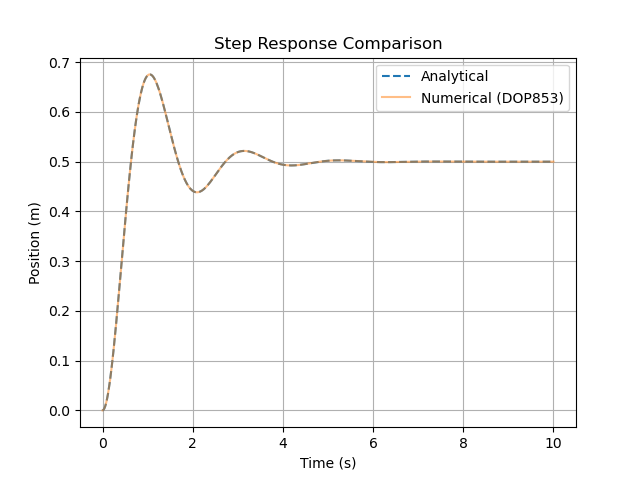
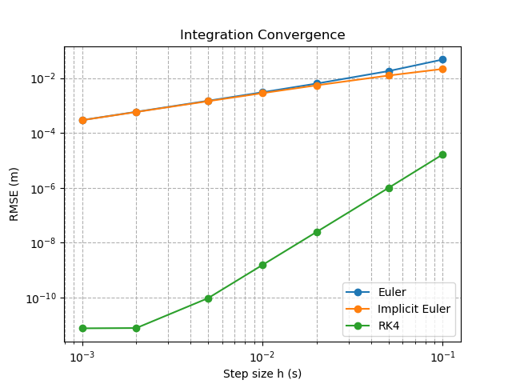
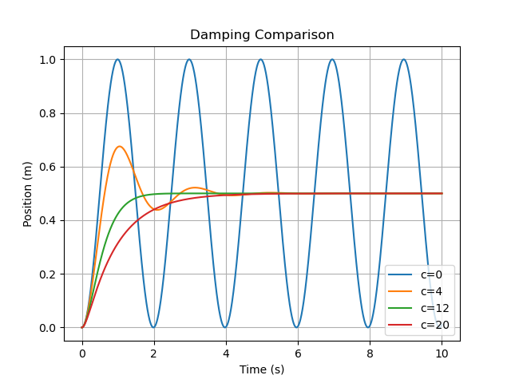
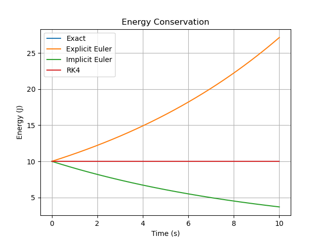

# Mass-Spring-Damper Project Report

## 1. System Description & 2. Assumptions

The system consists of a mass $m$ sliding horizontally on a frictionless surface, attached to a fixed wall via a linear spring with stiffness $k$ and a linear viscous damper with coefficient $c$. An external horizontal force $u(t)$ is applied to the mass. We assume the mass is a rigid body, the spring obeys Hooke's law, and the damper provides a force strictly proportional to velocity.

## 3. Free-Body Diagram

The forces acting on the mass in the horizontal direction are:

- Spring force: $F_s = -kx$
- Damping force: $F_d = -c\dot{x}$
- Applied external force: $F_a = u(t)$

## 4. Newton’s-Law Derivation

According to Newton's Second Law ($\sum F = m\ddot{x}$):

$$
m\ddot{x} = -kx - c\dot{x} + u(t)
$$

Rearranging gives the standard form:

$$
m\ddot{x} + c\dot{x} + kx = u(t)
$$

For $m=2$, $c=4$, $k=20$, this becomes:

$$
2\ddot{x} + 4\dot{x} + 20x = u(t) \implies \ddot{x} + 2\dot{x} + 10x = 0.5 u(t)
$$

## 5. State-Space Derivation

Let $x_1 = x$ and $x_2 = \dot{x}$. The state-space equations are:

$$
\dot{x}_1 = x_2
$$

$$
\dot{x}_2 = -10 x_1 - 2 x_2 + 0.5 u(t)
$$

In matrix form $\dot{x} = Ax + Bu$:

$$
A = \begin{bmatrix} 0 & 1 \\ -10 & -2 \end{bmatrix}, \quad B = \begin{bmatrix} 0 \\ 0.5 \end{bmatrix}
$$

## 6. Transfer-Function Derivation

Taking the Laplace transform with zero initial conditions

$$
(ms^2 + cs + k)X(s) = U(s)
$$

$$
G(s) = \frac{X(s)}{U(s)} = \frac{1}{ms^2 + cs + k} = \frac{0.5}{s^2 + 2s + 10}
$$

## 7. Pole and Stability Analysis

Comparing to $G(s) = \frac{K\omega_n^2}{s^2 + 2\zeta\omega_n s + \omega_n^2}$, we find

- Natural frequency $\omega_n = \sqrt{10} \approx 3.16$ rad/s
- Damping ratio $\zeta = \frac{2}{2\sqrt{10}} \approx 0.316$
  Since $0 < \zeta < 1$, the system is **underdamped**.
  The poles are at $s = -1 \pm 3j$. Since the real parts are strictly negative, the system is **stable**.

## 8. Analytical Response

For a step input $u(t) = 10$, the steady state is $x_{ss} = \frac{10}{20} = 0.5$ m.
The analytical underdamped step response matches the simulated one.

## 9. Numerical-Method Comparison

We evaluated Explicit Euler, Implicit Euler, and RK4 across various step sizes $h$.

As expected, Euler (both Explicit and Implicit) exhibits first-order convergence (error halves when $h$ halves), while RK4 exhibits fourth-order convergence.

## 10. Damping Study

Varying $c \in \{0, 4, 12, 20\}$ showed:

- $c=0$: Pure undamped oscillation
- $c=4$: Underdamped, oscillations decay
- $c=12, 20$: Overdamped/critically damped, no oscillations.
  

## 11. Energy Conservation

For $c=0, u(t)=0$, total energy $E = \frac{1}{2}m\dot{x}^2 + \frac{1}{2}kx^2$ is strictly conserved analytically.

- **Explicit Euler**: Adds energy over time due to forward approximation causing outward spiral in phase space.
- **Implicit Euler**: Removes energy over time, causing artificial numerical damping.
- **RK4**: Conserves energy extremely well over the given simulation horizon.
  

## 12. Limitations

The model assumes linear springs and dampers. In physical systems, springs can harden/soften at large extensions, and damping often has nonlinear components (like Coulomb friction).

## 13. Conclusions

 We have transition ourself from Newtonian physics to state-space and transfer-function representations, and finally to robust numerical simulation. The choice of integrator profoundly impacts accuracy and energy conservation in oscillatory dynamical systems.
