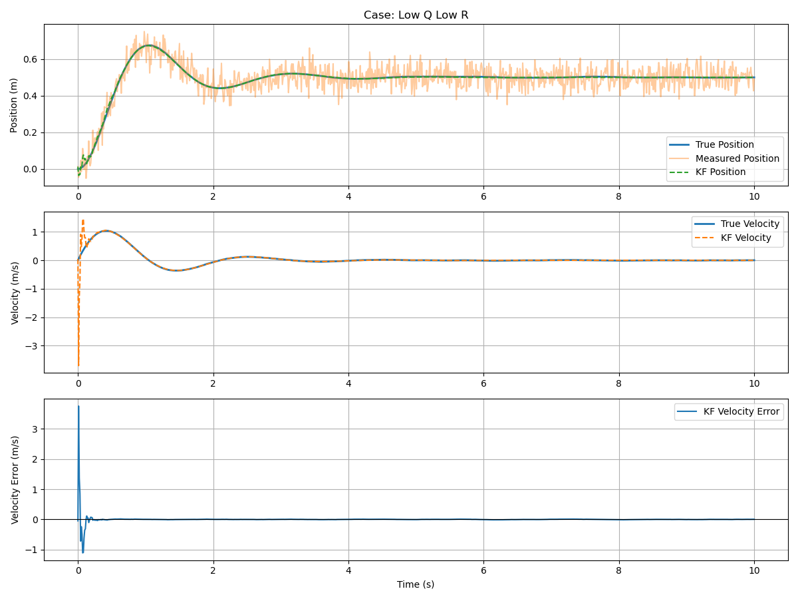
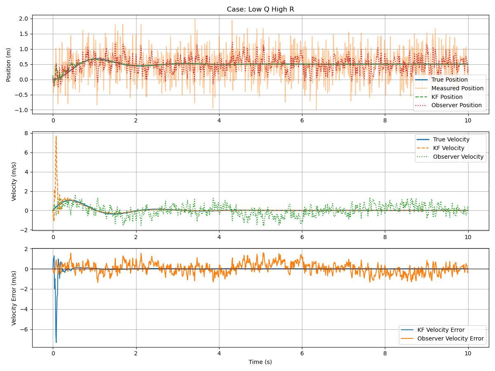
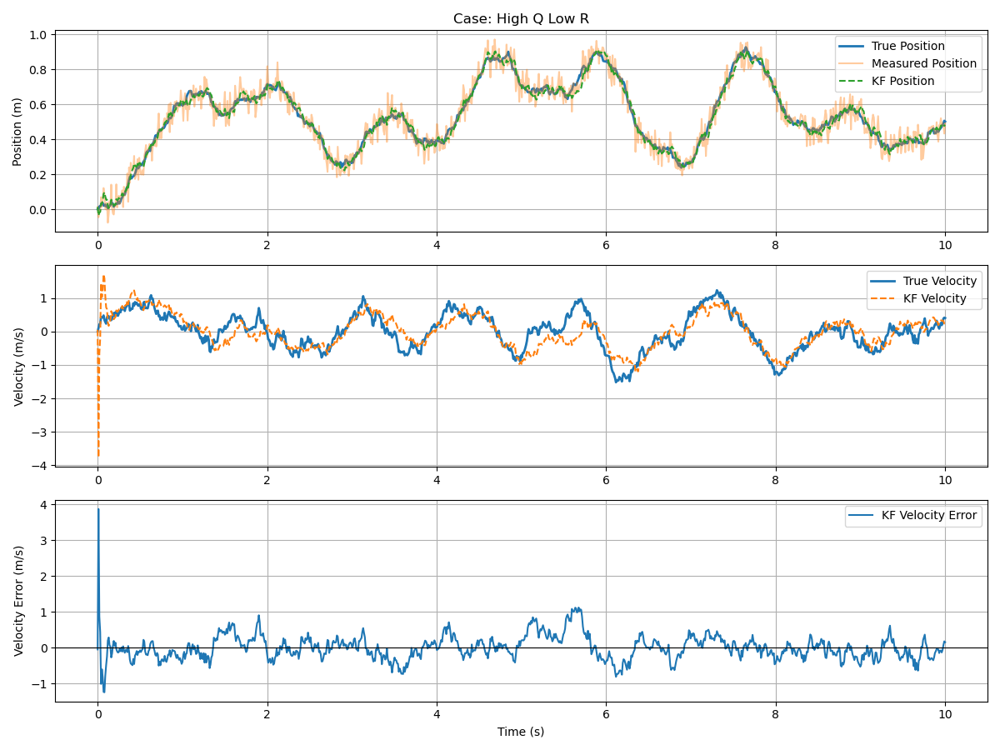
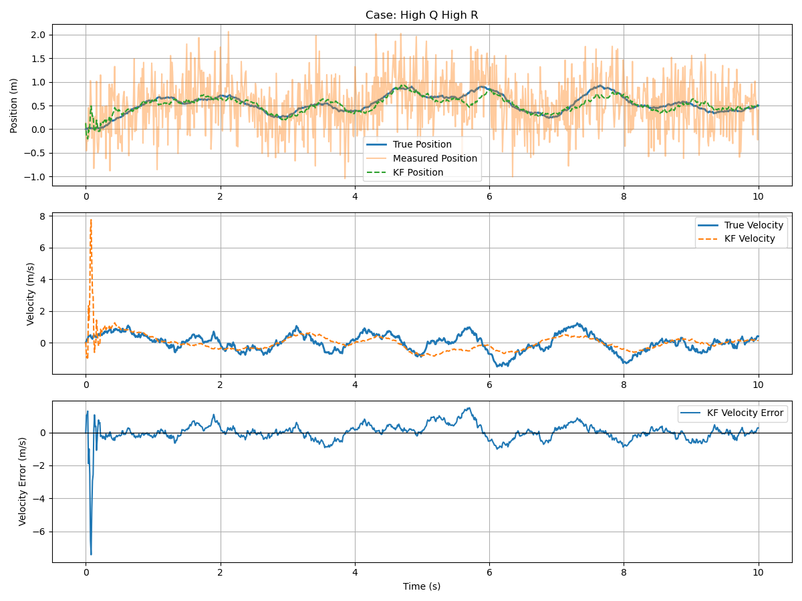

# Mass–Spring–Damper State Estimation: Recovering Velocity from Noisy Position Measurements

**One-line summary:** A state-estimation study comparing a discrete-time Kalman filter and a Luenberger observer for estimating unmeasured velocity in a mass–spring–damper system under varying process and measurement noise.

## 1. Problem and Motivation

In many mechanical systems, position is easy to measure (encoders, displacement sensors) but velocity is not directly available or is noisy when obtained by differentiation. Yet velocity is critical for monitoring, control, and fault detection. This project addresses the question: **can we reliably reconstruct hidden velocity from noisy position-only measurements using a known physics model?**

It also examines a practical design tension: when should we trust the model versus the sensor, and how does that choice affect accuracy and convergence?

## 2. Background (Physics/Math in Plain Language)

**Physical system:**
$$
m\ddot{x} + c\dot{x} + kx = u(t), \qquad m=2.0,\; c=4.0,\; k=20.0,\; u(t)=10\,\text{N}
$$

**State-space form:** with $x_1=x$ (position), $x_2=\dot{x}$ (velocity),
$$
\dot{x}=Ax+Bu,\quad y = Cx + v, \quad
A=\begin{bmatrix}0&1\\-10&-2\end{bmatrix},\;
B=\begin{bmatrix}0\\0.5\end{bmatrix},\;
C=\begin{bmatrix}1&0\end{bmatrix}
$$
Only position is measured ($C$ selects $x_1$), and $v$ represents measurement noise.

**Observability (can hidden states be inferred?):** the observability matrix
$$
\mathcal{O}=\begin{bmatrix}C\\CA\end{bmatrix}=\begin{bmatrix}1&0\\0&1\end{bmatrix}
$$
has full rank (2), so velocity is theoretically reconstructable from position measurements.

**Kalman filter intuition:** it runs a predict–correct loop.
- **Predict:** propagate state with the model ($A_d,B_d$) and accumulate uncertainty ($Q$).
- **Update:** correct prediction using measurement residual $(y_k - C\hat{x}_{k|k-1})$ weighted by Kalman gain $K_k$.
The gain balances trust: large measurement noise $R$ ⇒ trust model more; large process noise $Q$ ⇒ trust measurements more.

**Luenberger observer intuition:** a deterministic estimator that injects output error with gain $L$:
$$
\dot{\hat{x}} = A\hat{x} + Bu + L(y-C\hat{x})
$$
with $L$ chosen to place error dynamics poles in the stable left-half plane (fast convergence), but without explicitly modeling stochastic noise covariances.

## 3. Data and Setup

- **Sampling/discretization:** $T_s=0.01$ s, zero-order hold (ZOH) discretization via matrix exponential (`src/discretization.py`)
- **True system simulation:** includes process disturbance and measurement noise per case (`main.py`, `src/noise.py`)
- **Estimator initial conditions:** $\hat{x}_0=[0,0]^\top$, $P_0=100I$ (as configured)
- **Noise cases evaluated (reported):**

| Case | Process noise $Q$ | Measurement noise $R$ | Intent |
|---|---|---|---|
| Low $Q$, Low $R$ | low | low | near-ideal baseline |
| Low $Q$, High $R$ | low | high | poor sensor |
| High $Q$, Low $R$ | high | low | model uncertainty |
| High $Q$, High $R$ | high | high | challenging/noisy |

- **Observer comparison:** Luenberger observer included in reported comparison case (high measurement noise setting) with poles at $\lambda_{1,2}=-20\pm20i$

**Outputs:** `results/estimation_metrics.csv`, `results/metrics_summary.json`, figures in `results/figures/`, `results/report.md`.

## 4. Methods

| Component | Description | Repo location |
|---|---|---|
| Continuous dynamics | Mass–spring–damper state-space matrices and observability | `src/dynamics.py` |
| Discretization | ZOH $A_d,B_d$ computation | `src/discretization.py` |
| Noise generation | Process/measurement noise sampling per case | `src/noise.py` |
| Kalman filter | Predict/update with configurable $Q,R,P_0$ | `src/kalman_filter.py` |
| Luenberger observer | Gain design and observer update for comparison | `src/luenberger_observer.py` |
| Metrics & plotting | RMSE/MAE/bias/convergence and figures | `src/metrics.py`, `main.py` |

**Key equations (KF):**
$$
\hat{x}_{k|k-1}=A_d\hat{x}_{k-1|k-1}+B_d u_{k-1},\quad P_{k|k-1}=A_dP_{k-1|k-1}A_d^T+Q
$$
$$
K_k=P_{k|k-1}C^T(CP_{k|k-1}C^T+R)^{-1},\quad \hat{x}_{k|k}=\hat{x}_{k|k-1}+K_k(y_k-C\hat{x}_{k|k-1})
$$

## 5. Results and Analysis

### Quantitative summary

Source: `results/metrics_summary.json`, `results/report.md`

| Case | KF Pos. RMSE (m) | KF Vel. RMSE (m/s) | KF Vel. MAE (m/s) | KF Vel. Bias (m/s) | KF Conv. time (s) |
|---|---:|---:|---:|---:|---:|
| Low $Q$, Low $R$ | 0.00470 | **0.1437** | **0.01618** | -0.00066 | **0.22** |
| Low $Q$, High $R$ | 0.03612 | 0.3884 | 0.05607 | 0.02408 | 1.68 |
| High $Q$, Low $R$ | 0.02412 | 0.3487 | 0.25433 | -0.00076 | ∞ |
| High $Q$, High $R$ | 0.09478 | 0.5819 | 0.36365 | 0.00422 | ∞ |

**Luenberger observer (comparison case: Low $Q$, High $R$):** Pos. RMSE 0.2345 m, Vel. RMSE 0.5265 m/s, Vel. MAE 0.4222 m/s, no finite convergence by reported criterion.

### Interpretation

- **Best-case performance is strong and fast.** With low process and measurement noise, the Kalman filter reconstructs velocity accurately (RMSE 0.144 m/s) and converges in 0.22 s.
- **Sensor degradation slows estimation but KF remains robust.** When $R$ is high (poor sensor), the filter leans more on the model; convergence takes longer (1.68 s) and errors increase, but estimates remain far better than the observer in the reported comparison.
- **Model uncertainty is the harder regime.** High $Q$ cases do not reach the reported steady convergence criterion (∞), with substantially higher velocity MAE—when the model is unreliable, the filter must depend more on noisy measurements.
- **KF vs Luenberger under noisy sensing:** in the high-$R$ comparison, KF outperforms the fixed-gain observer on all reported position/velocity error metrics, illustrating the benefit of noise-aware optimal weighting when covariance information is reasonable.
- **Practical takeaway:** estimation quality depends not only on observability but on **correct noise modeling/tuning**; $Q$ and $R$ are design-critical.

### Figures (experiment outputs)

## 6. Limitations and Lessons

- **Model mismatch not fully explored:** experiments vary stochastic noise levels but assume the nominal linear model structure; real systems may have parameter drift or unmodeled nonlinearities.
- **Convergence criterion sensitivity:** “∞” convergence reflects the chosen threshold/window in analysis; qualitative tracking may still be acceptable for some uses.
- **Observer tuning scope:** only one Luenberger pole placement is reported; alternative gains could improve deterministic response but still lack KF’s stochastic optimality framing.
- **Single-sensor setup:** only position is measured; multi-sensor fusion (e.g. adding acceleration) could significantly improve velocity estimates.
- **Control coupling not included:** this is an estimation study; combined observer-controller performance (separation principle in practice) requires closed-loop validation.

## 7. Tech Stack and Repo Link

- **Language:** Python 3
- **Libraries (from implementation):** NumPy, SciPy, pandas, Matplotlib
- **Run:** `cd mass_spring_damper_estimation && python3 main.py`
- **Tests:** `cd mass_spring_damper_estimation && python3 -m pytest -q`
- **Key outputs:** `results/estimation_metrics.csv`, `results/metrics_summary.json`, `results/figures/`, `results/report.md`
- **Repository:** local workspace project folder `mass_spring_damper_estimation/` (add remote GitHub URL here if/when published)
