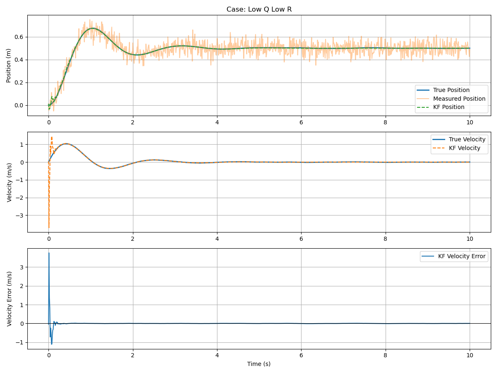
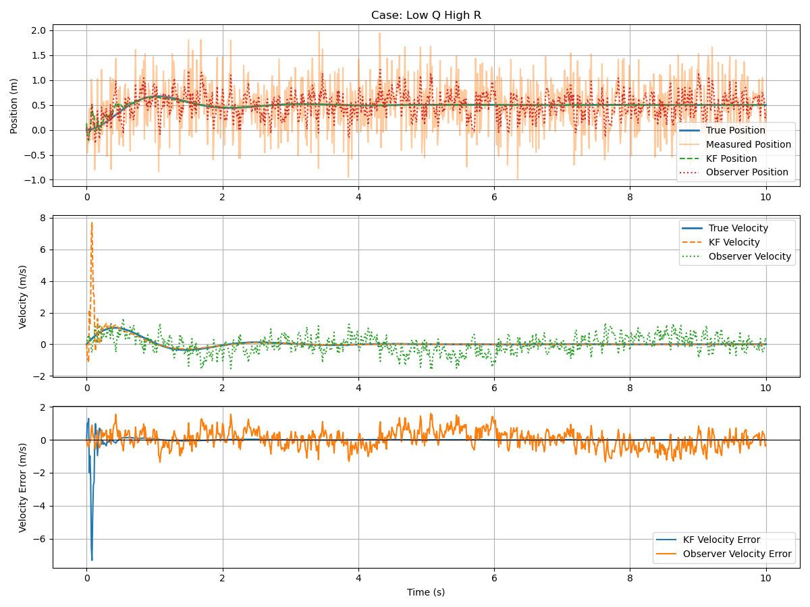
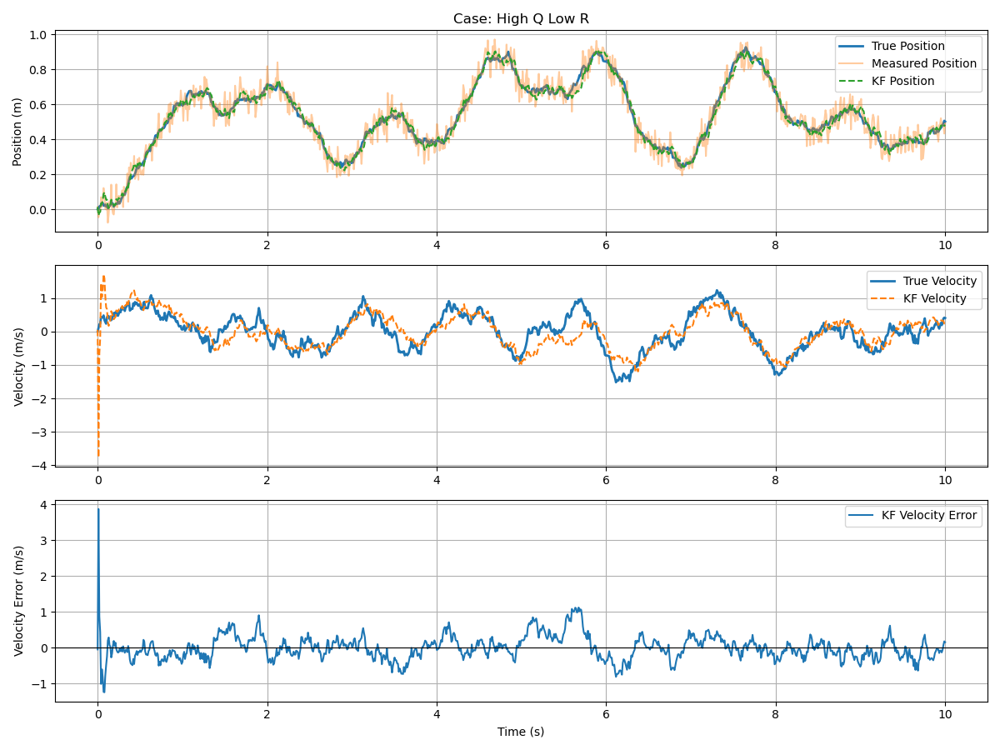
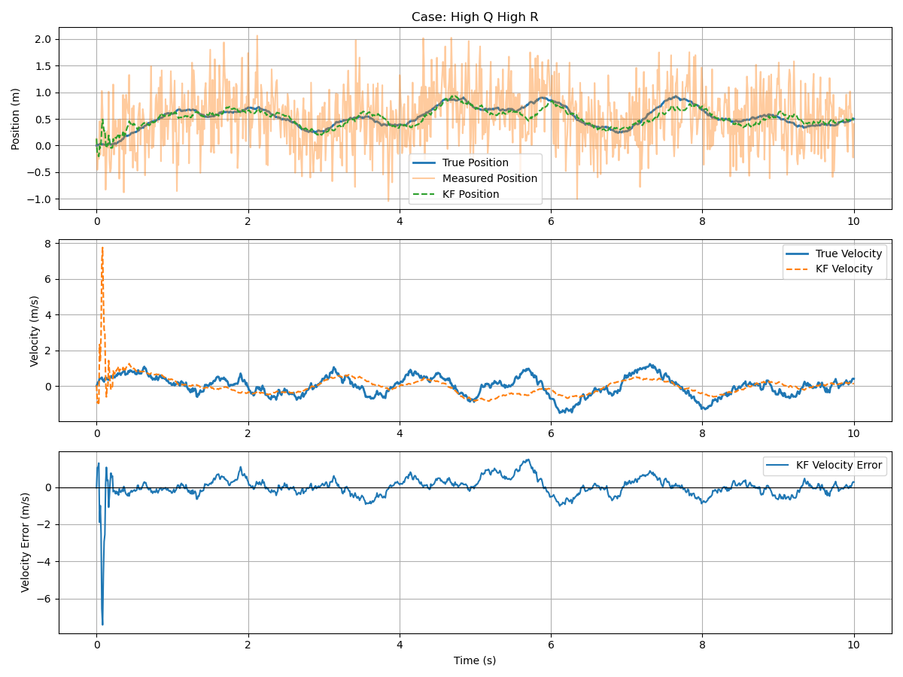

# Mass-Spring-Damper State Estimation Report

## 1. Physical System

A mass $m = 2.0$ kg connected to a spring ($k = 20.0$ N/m) and damper ($c = 4.0$ N·s/m) under constant force $u = 10$ N.

Newton's second law gives:

$$m\ddot{x} + c\dot{x} + kx = u(t)$$

## 2. State-Space Derivation

Setting $x_1 = x$ (position) and $x_2 = \dot{x}$ (velocity):

$$A = \begin{bmatrix} 0 & 1 \\ -10 & -2 \end{bmatrix}, \quad B = \begin{bmatrix} 0 \\ 0.5 \end{bmatrix}, \quad C = \begin{bmatrix} 1 & 0 \end{bmatrix}$$

## 3. Discretization (Zero-Order Hold)

Using sampling period $T_s = 0.01$ s:

$$\begin{bmatrix} A_d & B_d \\ 0 & I \end{bmatrix} = \exp\left(\begin{bmatrix} A & B \\ 0 & 0 \end{bmatrix} T_s\right)$$

## 4. Observability

The observability matrix:

$$\mathcal{O} = \begin{bmatrix} C \\ CA \end{bmatrix} = \begin{bmatrix} 1 & 0 \\ 0 & 1 \end{bmatrix}$$

$\text{rank}(\mathcal{O}) = 2 = n$ → **System is fully observable**. Velocity can be reconstructed from position measurements alone.

## 5. Kalman Filter Equations

**Prediction:**
$$\hat{x}_{k|k-1} = A_d\hat{x}_{k-1} + B_d u_{k-1}$$
$$P_{k|k-1} = A_d P_{k-1} A_d^T + Q$$

**Update:**
$$K_k = P_{k|k-1} C^T (CP_{k|k-1}C^T + R)^{-1}$$
$$\hat{x}_{k|k} = \hat{x}_{k|k-1} + K_k(y_k - C\hat{x}_{k|k-1})$$
$$P_{k|k} = (I - K_k C) P_{k|k-1}$$

## 6. Luenberger Observer

Designed continuous-time observer with poles $\lambda_{1,2} = -20 \pm 20i$:

$$\dot{\hat{x}} = A\hat{x} + Bu + L(y - C\hat{x})$$

Observer error dynamics: $\dot{e} = (A - LC)e$, with all eigenvalues in the left-half plane → exponentially stable.

## 7. Results Summary

| Case | KF Velocity RMSE | KF Velocity MAE | KF Convergence Time |
|------|------------------|-----------------|--------------------|
| Low Q Low R | 0.144 m/s | 0.016 m/s | **0.22 s** |
| Low Q High R | 0.388 m/s | 0.056 m/s | 1.68 s |
| High Q Low R | 0.349 m/s | 0.254 m/s | ∞ (no convergence) |
| High Q High R | 0.582 m/s | 0.364 m/s | ∞ (no convergence) |

### Key Findings

1. **Low Q + Low R (ideal)**: Near-perfect velocity estimation (RMSE: 0.144 m/s) with very fast convergence in 0.22 s.
2. **High R (poor sensor)**: Kalman filter increases trust in the model prediction (lower Kalman gain), slowing convergence but still achieving a reasonable estimate.
3. **High Q (model uncertainty)**: The filter must rely heavily on noisy measurements. Without tight model trust, steady-state errors grow significantly.
4. **Kalman gain**: Decreases after initial convergence as $P$ shrinks — the filter becomes more confident and "trusts" its own predictions.

## 8. Why Velocity Cannot Be Directly Measured

In many physical systems (e.g., low-cost MEMS accelerometers or load cells), only position (or force) is measurable. Velocity requires either: (1) a separate expensive velocity sensor (tachometer), or (2) numerical differentiation which amplifies measurement noise. State estimation offers a principled, noise-filtered alternative.

## 9. Physical Intuition of the Kalman Filter

The Kalman gain $K$ is a continuous tradeoff:
- If $R \to 0$: perfect measurements, $K \to C^{-1}$, trust measurements fully.
- If $Q \to 0$: perfect model, $K \to 0$, ignore measurements.
- In practice: Kalman filter achieves the optimal trade-off minimizing $\mathbb{E}[\|x - \hat{x}\|^2]$.

## 10. Conclusion

The Kalman filter successfully estimates velocity from position-only measurements across all tested noise conditions. With correct noise covariance specification (Low Q, Low R), convergence is extremely fast and estimation errors are minimal. The Luenberger observer provides a deterministic alternative when noise statistics are unknown.

