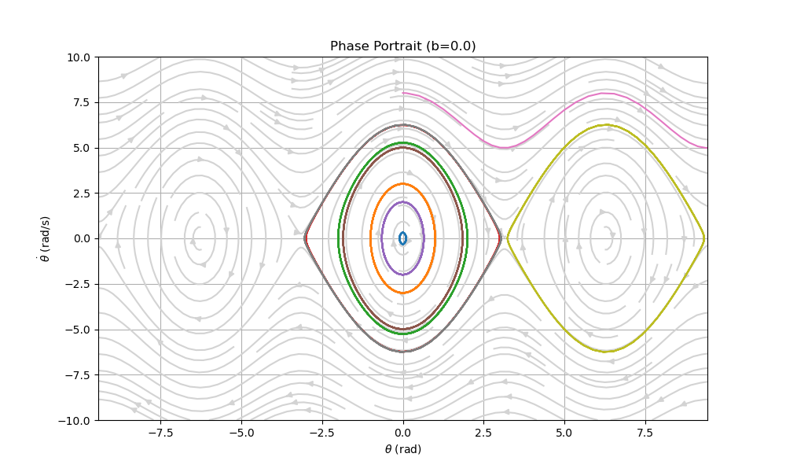
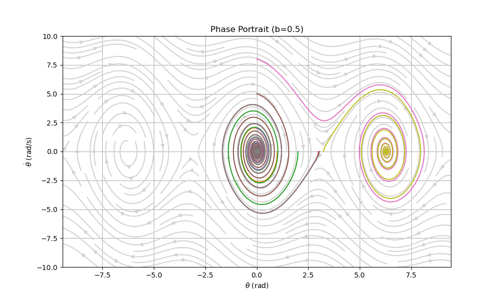
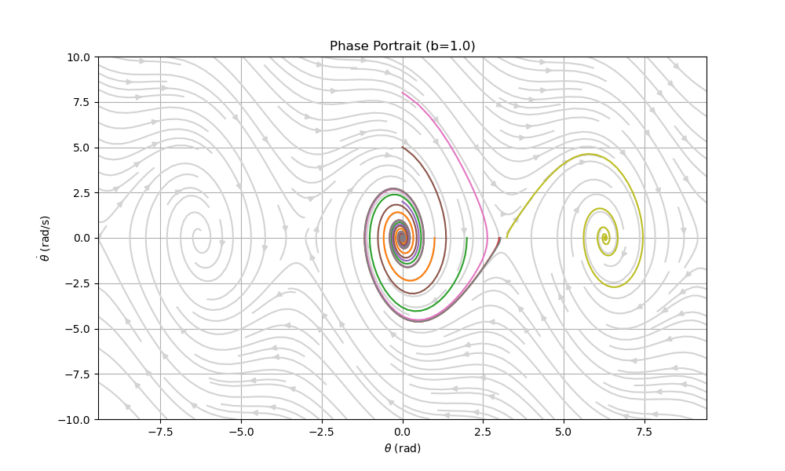
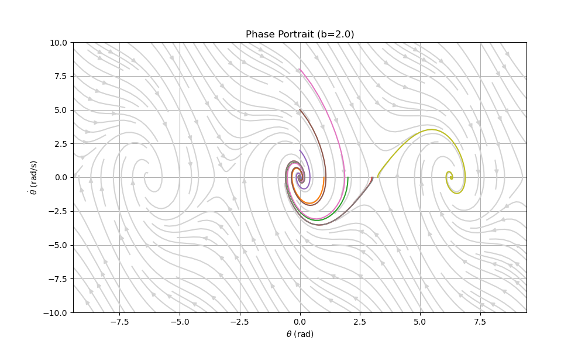
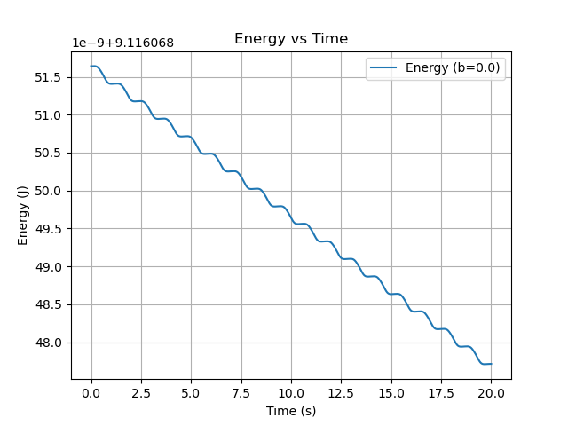
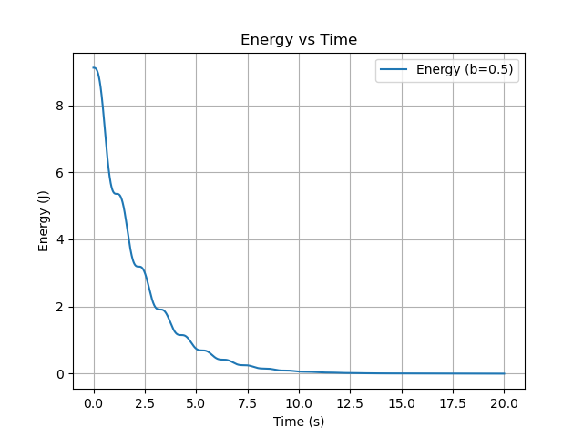
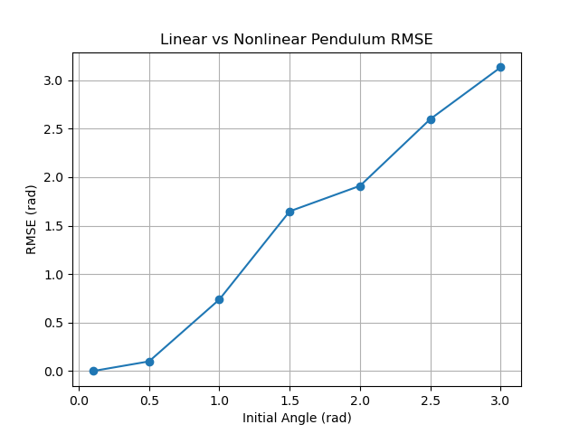

# Nonlinear Pendulum: Equilibria, Stability, Phase Portraits, and Energy

**One-line summary:** A nonlinear dynamics study of a pendulum that analyzes equilibria and stability, visualizes phase portraits across damping regimes, and quantifies when the small-angle linear approximation breaks down.

## 1. Problem and Motivation

The pendulum is one of the simplest systems that becomes genuinely nonlinear once large angles are allowed. That nonlinearity creates behaviors linear models cannot capture: multiple equilibria, separatrices between oscillation and rotation, and amplitude-dependent motion.

Understanding these phenomena is essential before moving to nonlinear control, state estimation, or simulation of real mechanical systems where “small-angle” assumptions do not hold.

## 2. Background (Physics/Math in Plain Language)

**Equation of motion:** for angle $\theta$ from downward vertical (with viscous damping $b$),
$$
mL^2\ddot{\theta} + b\dot{\theta} + mgL\sin\theta = \tau(t)
$$
In this study $\tau(t)=0$ and parameters are $m=1.0$ kg, $L=1.0$ m, $g=9.81$ m/s², with damping swept over $b\in\{0,0.1,0.5,1.0,2.0,5.0\}$.

**State-space form:** with $x_1=\theta$, $x_2=\dot{\theta}$,
$$
\dot{x}_1=x_2,\qquad \dot{x}_2 = -\frac{g}{L}\sin x_1 - \frac{b}{mL^2}x_2
$$

**Equilibria:** points where motion stops changing ($\dot{x}_1=\dot{x}_2=0$) occur at $(\theta,\dot{\theta})=(n\pi,0)$.
- $(0,0)$: hanging down (lowest energy)
- $(\pi,0)$: balanced upright (high energy, delicate)

**Stability intuition:** linearize near an equilibrium using the Jacobian. If perturbations decay, it’s stable; if they grow in some direction, it’s unstable (saddle). For the upright equilibrium, one eigenvalue has positive real part across tested damping values, so it is unstable.

**Energy view:** total mechanical energy
$$
E(\theta,\dot{\theta})=\frac{1}{2}mL^2\dot{\theta}^2 + mgL(1-\cos\theta), \qquad \frac{dE}{dt}=-b\dot{\theta}^2
$$
So energy is conserved when $b=0$ and dissipated when $b>0$.

## 3. Data and Setup

- **Model:** nonlinear pendulum (and linearized comparison model $\sin\theta \approx \theta$)
- **Baseline parameters:** $m=1.0$ kg, $L=1.0$ m, $g=9.81$ m/s², $\tau=0$
- **Damping values:** $b \in \{0.0, 0.1, 0.5, 1.0, 2.0, 5.0\}$ N·m·s
- **Analyses performed (per `main.py`):**
  - Equilibrium/eigenvalue classification for each damping value
  - Phase portraits from multiple initial conditions over $t\in[0,20]$ s
  - Energy analysis from $(\theta_0,\dot{\theta}_0)=(1.5,0)$
  - Linear vs nonlinear RMSE over $\theta_0 \in \{0.1,0.5,1.0,1.5,2.0,2.5,3.0\}$ rad
- **Saved artifacts:** `results/equilibria.csv`, `results/linear_vs_nonlinear.csv`, figures in `results/figures/`, `results/report.md`

## 4. Methods

| Component | Description | Repo location |
|---|---|---|
| Dynamics models | Nonlinear and linear pendulum RHS | `src/pendulum_dynamics.py` |
| Equilibrium/stability | Equilibria at $(n\pi,0)$, Jacobian/eigenvalues, classification | `src/equilibrium_analysis.py` |
| Phase portraits | Vector/trajectory plots across damping and ICs | `src/phase_portrait.py` |
| Energy analysis | $E(t)$ and dissipation behavior per damping case | `src/energy_analysis.py` |
| Linear vs nonlinear | Trajectory comparison and RMSE vs initial angle | `src/linear_vs_nonlinear.py` |
| Driver | Batch experiments and CSV/figure export | `main.py` |

## 5. Results and Analysis

### Equilibria and stability (from `results/equilibria.csv`)

- **Downward equilibrium $(0,0)$:** stable for all $b>0$ cases tested (complex conjugate eigenvalues with negative real parts → decaying oscillations/spirals; stronger damping changes decay character).
- **Upright equilibrium $(\pi,0)$:** unstable for all tested $b\ge 0$ (one positive and one negative real eigenvalue → saddle behavior).
- **Undamped case ($b=0$):** $(0,0)$ is a center in linearized analysis (purely imaginary eigenvalues), consistent with closed orbits/energy conservation in the ideal model.

### Phase portraits and energy behavior

- **$b=0$:** closed orbits (oscillation) and rotational trajectories separated by a separatrix structure; total energy remains constant in the idealized case.
- **$b>0$:** trajectories spiral toward stable downward equilibria as energy dissipates ($\dot{E}=-b\dot{\theta}^2 \le 0$); higher damping reduces oscillatory ringing.

### Linear vs nonlinear approximation error

Source: `results/linear_vs_nonlinear.csv`

| Initial angle $\theta_0$ (rad) | RMSE (linear vs nonlinear) |
|---:|---:|
| 0.1 | 0.00080 |
| 0.5 | 0.10058 |
| 1.0 | 0.73910 |
| 1.5 | 1.64830 |
| 2.0 | 1.91101 |
| 2.5 | 2.59946 |
| 3.0 | 3.13329 |

**Interpretation:** error grows rapidly with amplitude. For small angles, $\sin\theta\approx\theta$ is accurate; for large angles the restoring term $\sin\theta$ is weaker than $\theta$, producing amplitude-dependent period and phase drift that a constant-period linear model cannot match.

### Figures (experiment outputs)

**Phase portraits**  

**Energy**  

**Linear vs nonlinear**  

*(Additional figures for other damping values are available in `results/figures/`.)*

## 6. Limitations and Lessons

- **Idealized damping/friction:** viscous damping only; real pivots may include Coulomb friction, air drag, or joint compliance.
- **Modeling assumptions:** rigid massless rod and point mass; flexibility and distributed mass are neglected.
- **Local linearization limits:** eigenvalue analysis classifies local behavior near equilibria but does not fully describe global nonlinear trajectories (hence phase portraits are essential).
- **Unforced study focus:** main results are for $\tau=0$; forced/chaotic regimes require separate careful analysis and numerical validation.
- **Numerical dependence:** phase/energy conclusions assume sufficiently accurate integration; results should be interpreted alongside solver/timestep choices used in scripts.

## 7. Tech Stack and Repo Link

- **Language:** Python 3
- **Libraries (from implementation):** NumPy, SciPy, pandas, Matplotlib
- **Run:** `cd nonlinear_pendulum && python3 main.py`
- **Tests:** `cd nonlinear_pendulum && python3 -m pytest -q`
- **Key outputs:** `results/equilibria.csv`, `results/linear_vs_nonlinear.csv`, `results/figures/`, `results/report.md`
- **Repository:** local workspace project folder `nonlinear_pendulum/` (add remote GitHub URL here if/when published)
