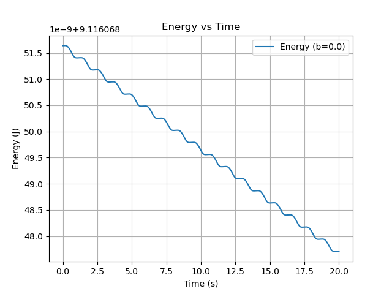
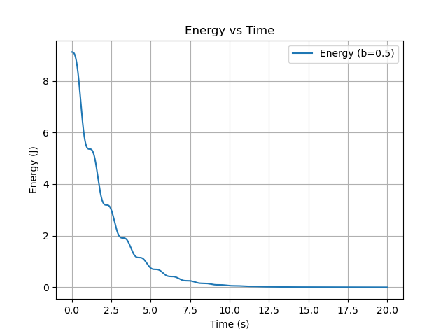
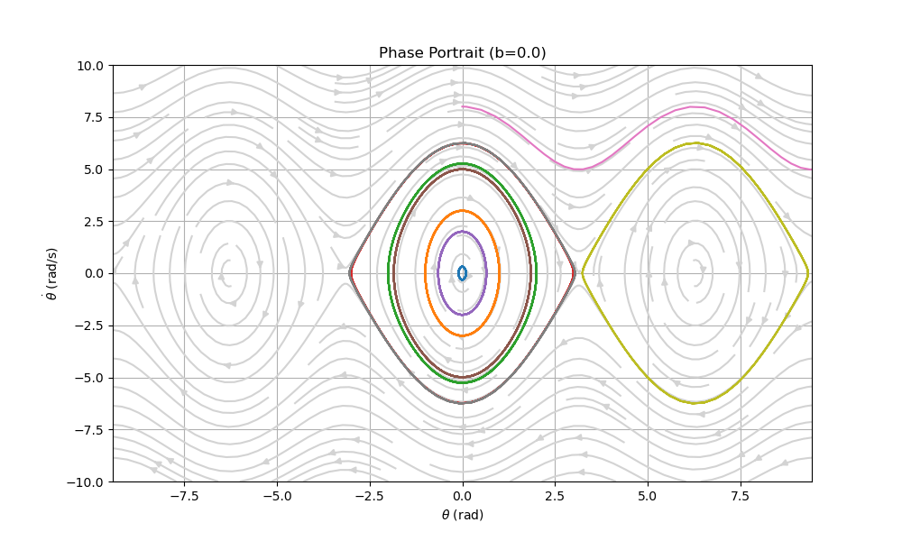
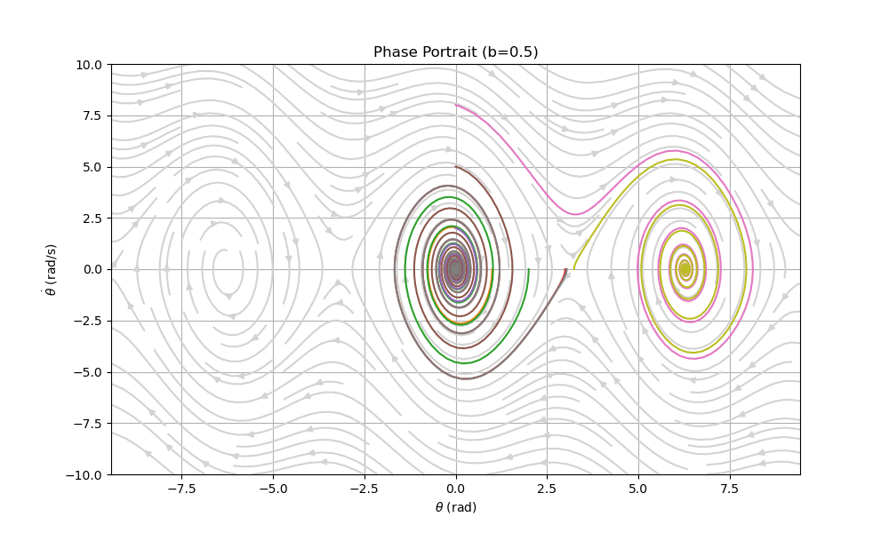
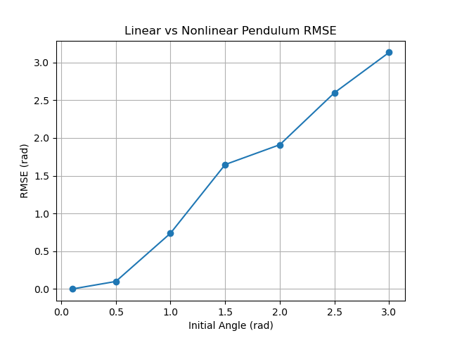

# Nonlinear Pendulum Project Report

## 1. Physical Description and Assumptions
We analyze a pendulum beyond the small-angle approximation. The pendulum consists of a mass $m$ at the end of a rigid, massless rod of length $L$. Damping is modeled as viscous friction $b\dot{\theta}$. We assume $m=1.0$ kg, $L=1.0$ m, $g=9.81$ m/s$^2$. 

## 2. Nonlinear Equation of Motion
The nonlinear ODE derived from torque balances is:
$$ mL^2\ddot{\theta} + b\dot{\theta} + mgL\sin\theta = 0 $$

## 3. First-Order State-Space Form
Let $x_1 = \theta$ and $x_2 = \dot{\theta}$. The first-order system is:
$$ \dot{x}_1 = x_2 $$
$$ \dot{x}_2 = -\frac{g}{L}\sin x_1 - \frac{b}{mL^2}x_2 $$

## 4. Equilibrium Analysis
Equilibria occur when $\dot{x}_1 = \dot{x}_2 = 0$.
This means $x_2^* = 0$ and $\sin x_1^* = 0 \implies x_1^* = n\pi$ for $n \in \mathbb{Z}$.
Physically, $x_1 = 0$ is the pendulum hanging straight down, and $x_1 = \pi$ is the pendulum standing upright. Due to periodicity, we restrict $x_1 \in [-\pi, \pi]$.

## 5. Jacobian and Linearization
The Jacobian evaluated at an equilibrium $(x_1^*, 0)$ is:
$$ J(x^*) = \begin{bmatrix} 0 & 1 \\ -\frac{g}{L}\cos x_1^* & -\frac{b}{mL^2} \end{bmatrix} $$

## 6. Eigenvalue and Stability Classification
For the downward equilibrium $(0, 0)$: $\cos(0) = 1$. The eigenvalues are $\lambda = -\frac{b}{2mL^2} \pm \sqrt{\left(\frac{b}{2mL^2}\right)^2 - \frac{g}{L}}$.
- For $b > 0$, the real parts are strictly negative (Stable Spiral or Node).
- For $b = 0$, the real parts are zero, purely imaginary eigenvalues (Center).

For the upright equilibrium $(\pi, 0)$: $\cos(\pi) = -1$. One eigenvalue will have a positive real part, making it a saddle point (unstable).

## 7. Energy Derivation and Conservation/Dissipation
The total mechanical energy is $E(\theta, \dot{\theta}) = \frac{1}{2}mL^2\dot{\theta}^2 + mgL(1-\cos\theta)$.
Taking the time derivative gives $\frac{dE}{dt} = -b\dot{\theta}^2$.
If $b=0$, energy is conserved ($\frac{dE}{dt} = 0$). If $b>0$, energy is strictly non-increasing ($\frac{dE}{dt} \leq 0$), causing the pendulum to spiral towards the lowest energy state (downward equilibrium).

## 8. Phase Portraits
The phase portrait maps $(\theta, \dot{\theta})$.
- **Undamped ($b=0$)**: Features closed orbits (oscillations) inside a separatrix, and open wavy trajectories (rotations) outside.
- **Damped ($b>0$)**: Rotations eventually cross the separatrix and turn into decaying spirals terminating at $(0, 0), (2\pi, 0)$, etc.

## 10. Linear versus Nonlinear Comparison
The small-angle linear model replaces $\sin\theta \approx \theta$. We simulated both models for initial angles $\theta_0 \in [0.1, 3.0]$ rad.

For small $\theta_0 \le 0.5$ rad, the RMSE is tiny because $\sin\theta \approx \theta$ holds tightly. For large angles, $\sin\theta < \theta$ significantly, so the nonlinear pendulum has a softer restoring force, causing the period of oscillation to lengthen depending on the amplitude. The linear model has a constant period regardless of amplitude, causing immense phase drift (error) over time.

## 13. Limitations
This model assumes rigid rods and perfect viscous damping. It ignores aerodynamic drag ($\propto v^2$) and dry Coulomb friction. It also assumes a rigid pivot.

## 14. Conclusions
Analyzing the full nonlinear dynamics uncovers phenomena inaccessible to linear analysis: the presence of multiple isolated equilibria, bifurcating separatrices distinguishing rotation from oscillation, and amplitude-dependent frequency. The energetic approach mathematically guarantees asymptotic stability for all non-zero viscous damping.
