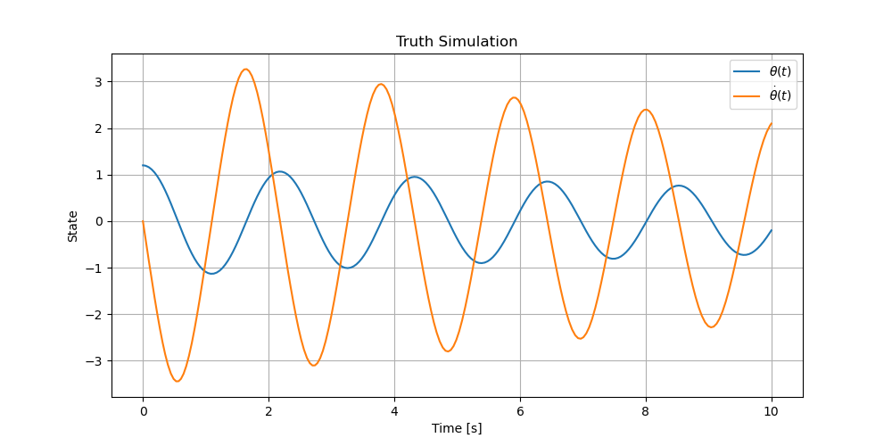
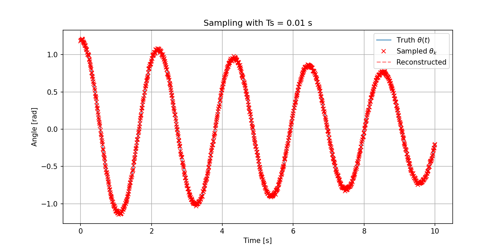
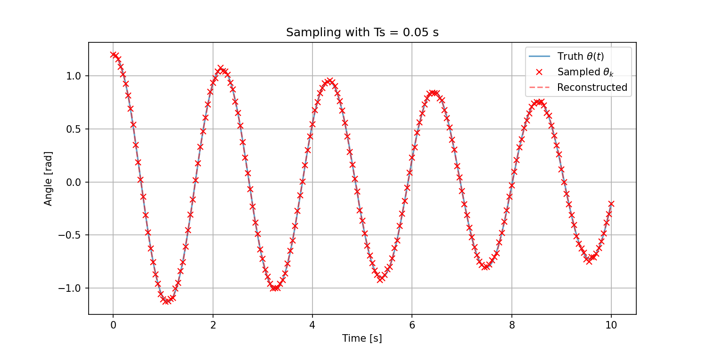
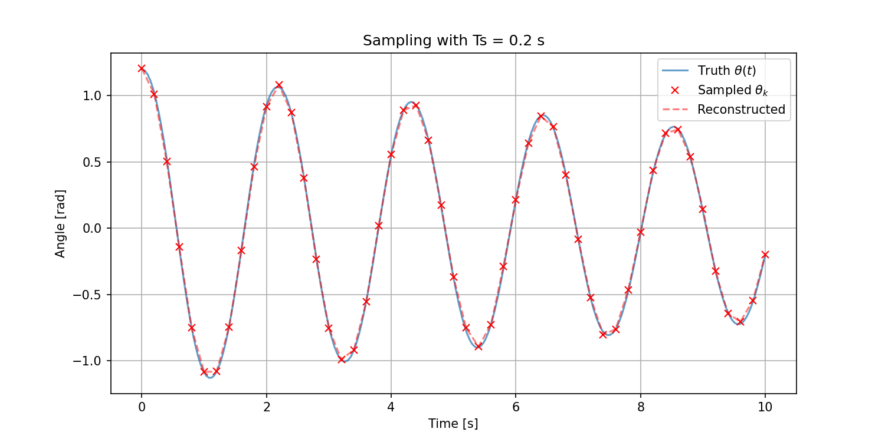
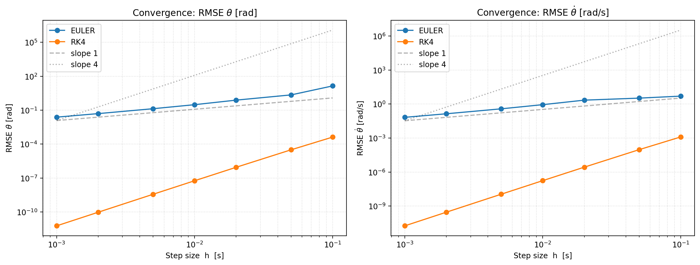
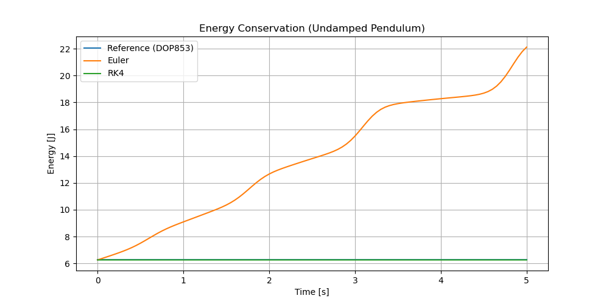

# Pendulum Sampling Study: Simulation, Measurement Noise, Aliasing, and Numerical Integration

**One-line summary:** A pendulum simulation study showing how integrator choice, measurement noise, and sampling period affect trajectory accuracy, velocity estimation, energy behavior, and signal reconstruction.

## 1. Problem and Motivation

Digital control and data-driven modeling pipelines never observe a physical system continuously—they see **sampled, noisy measurements** produced by numerical simulation or sensors. Poor choices in integration method, step size, or sampling rate can create errors that look like “physics” but are actually artifacts.

This project uses a damped simple pendulum to quantify three coupled issues: (1) numerical integration accuracy, (2) measurement noise effects, and (3) sampling/reconstruction trade-offs (including noise amplification in numerical differentiation).

## 2. Background (Physics/Math in Plain Language)

**Dynamics:** for a pendulum of mass $m$ and length $L$ with viscous damping $b$,
$$
mL^2\ddot{\theta} + b\dot{\theta} + mgL\sin\theta = \tau(t)
$$
In state form ($x_1=\theta, x_2=\dot{\theta}$):
$$
\dot{x}_1=x_2,\qquad \dot{x}_2 = -\frac{g}{L}\sin x_1 - \frac{b}{mL^2}x_2 + \frac{\tau(t)}{mL^2}
$$

**Measurement model:** only angle is measured at sampling times $t_k=kT_s$ with additive Gaussian noise
$$
\theta[k]=\theta(t_k)+v_k,\qquad v_k\sim\mathcal{N}(0,\sigma_\theta^2),\quad \sigma_\theta=0.01\,\text{rad}
$$

**Sampling intuition:**
- **Too slow:** misses dynamics / risks aliasing (high frequencies appear as false low frequencies).
- **Too fast:** position samples look clean, but finite-difference velocity $\hat{\dot{\theta}}_k \approx (\theta_{k+1}-\theta_k)/T_s$ can amplify noise severely.

**Integrator intuition:**
- **Euler:** simple, first-order, can accumulate large error and distort energy.
- **RK4:** fourth-order, much more accurate per step for smooth dynamics.
- **Adaptive high-order (DOP853):** tight-tolerance reference for “truth”.

## 3. Data and Setup

- **Baseline parameters:** $m=1.0$ kg, $L=1.0$ m, $g=9.81$ m/s², $b=0.1$ N·m·s
- **Initial conditions:** $\theta(0)=1.2$ rad, $\dot{\theta}(0)=0$ rad/s
- **Truth/reference simulation:** DOP853 with very tight tolerances (`rtol=1e-12`, `atol=1e-14`) over $t\in[0,10]$ s
- **Sampling periods studied:** $T_s \in \{0.001,0.005,0.01,0.02,0.05,0.1,0.2,0.5\}$ s ($\sigma_\theta=0.01$ rad)
- **Integrator study (fixed-step):** Euler and RK4 for $h \in \{0.1,0.05,0.02,0.01,0.005,0.002,0.001\}$ s
- **Energy study:** undamped comparison ($b=0$) over shorter horizon (per `main.py`) including Euler/RK4/reference

**Artifacts:** `results/truth_simulation.csv`, `results/sampling_study.csv`, `results/integrator_study.csv`, figures in `results/figures/`, `results/report.md`.

## 4. Methods

| Component | Description | Repo location |
|---|---|---|
| Simulator | `PendulumSimulator` with nonlinear RHS and Euler/RK4/SciPy solvers | `src/pendulum.py` |
| Measurement/sampling | Noisy sampling, reconstruction, finite-difference velocity, error metrics | `src/measurement.py`, `src/analysis.py` |
| Integrator comparison | Fixed-step convergence vs high-accuracy reference | `src/integrators.py` |
| Experiment driver | Truth run, sampling/integrator/energy studies, plots/CSVs | `main.py` |

**Reported evaluation:** position/velocity MAE & RMSE vs reference/truth in sampling study; RMSE vs step size for integrators; qualitative/quantitative energy behavior in undamped case.

## 5. Results and Analysis

### Sampling and measurement-noise effects

Source: `results/sampling_study.csv`

| $T_s$ (s) | $f_s$ (Hz) | $f_N$ (Hz) | Pos. RMSE (rad) | Vel. RMSE (rad/s) | Aliasing observed |
|---:|---:|---:|---:|---:|:---:|
| 0.001 | 1000 | 500.0 | 0.00992 | **14.001** | No |
| 0.005 | 200  | 100.0 | 0.01008 | 2.810 | No |
| 0.010 | 100  | 50.0  | 0.01045 | 1.482 | No |
| 0.020 | 50   | 25.0  | 0.01011 | 0.706 | No |
| 0.050 | 20   | 10.0  | 0.01014 | 0.327 | No |
| 0.100 | 10   | 5.0   | 0.00940 | 0.328 | No |
| 0.200 | 5    | 2.5   | 0.00980 | 0.606 | No |
| 0.500 | 2    | 1.0   | 0.00967 | 1.584 | No |

**Interpretation:**
- **Position error stays near sensor-noise scale** (~0.01 rad) across all tested rates, but **velocity error is highly sampling-dependent**.
- **Very fast sampling amplifies differentiation noise:** at $T_s=0.001$ s, finite differences magnify measurement noise, producing very large velocity RMSE despite dense sampling.
- **Very slow sampling loses dynamics:** at $T_s=0.5$ s, Nyquist frequency ($1$ Hz) is only marginally above the pendulum’s fundamental (~0.5 Hz), degrading derivative/trajectory fidelity (and increasing aliasing risk outside tested regimes).
- **Practical sweet spot:** intermediate $T_s$ values (here ~0.05–0.1 s) balance temporal resolution and noise amplification for velocity estimates.

### Numerical integrator comparison

Source: `results/integrator_study.csv` (vs high-accuracy reference)

| $h$ (s) | Euler RMSE $\theta$ (rad) | RK4 RMSE $\theta$ (rad) | Euler RMSE $\dot{\theta}$ | RK4 RMSE $\dot{\theta}$ |
|---:|---:|---:|---:|---:|
| 0.100 | 13.874 | 4.172e-04 | 5.017 | 1.265e-03 |
| 0.010 | 0.305  | 5.779e-08 | 0.887 | 1.764e-07 |
| 0.001 | 0.0241 | 5.935e-12 | 0.0676 | 1.811e-11 |

**Interpretation:** Euler exhibits first-order behavior and large trajectory errors, while RK4 shows fourth-order convergence with near-reference accuracy at small/moderate step sizes for this smooth problem.

### Energy behavior (undamped, reported)

In the undamped setting, total mechanical energy should remain constant. The experiments/report show explicit Euler injecting numerical energy (drift/growth), whereas RK4 closely tracks the reference over the tested interval.

### Figures (experiment outputs)

**Truth trajectory**  

**Sampling examples**  

**Integrator and energy studies**  

*(Additional sampling plots for other $T_s$ values are available in `results/figures/`.)*

## 6. Limitations and Lessons

- **Simplified sensing model:** Gaussian white noise and no quantization/sensor bias; real encoders include discretization and non-Gaussian effects.
- **Differentiation baseline is naive:** finite differences are shown intentionally; practical systems use filtering/observers (e.g. Kalman filters) to estimate velocity robustly.
- **No actuator/loop delays modeled:** study focuses on simulation/sensing, not closed-loop control with delays or constraints.
- **Aliasing analysis scope:** tested $T_s$ values avoid overt aliasing of the dominant mode; more aggressive undersampling would be needed to demonstrate aliasing artifacts explicitly.
- **Generalization:** conclusions are parameter- and signal-dependent; different damping/forcing regimes shift optimal sampling and integrator choices.

## 7. Tech Stack and Repo Link

- **Language:** Python 3
- **Dependencies:** see `requirements.txt` (NumPy, SciPy, Matplotlib, pandas, pytest)
- **Run:** `cd pendulum_sampling && python3 -m pip install -r requirements.txt && python3 main.py`
- **Tests:** `cd pendulum_sampling && python3 -m pytest -q`
- **Key outputs:** `results/truth_simulation.csv`, `results/sampling_study.csv`, `results/integrator_study.csv`, `results/figures/`, `results/report.md`
- **Repository:** local workspace project folder `pendulum_sampling/` (add remote GitHub URL here if/when published)
