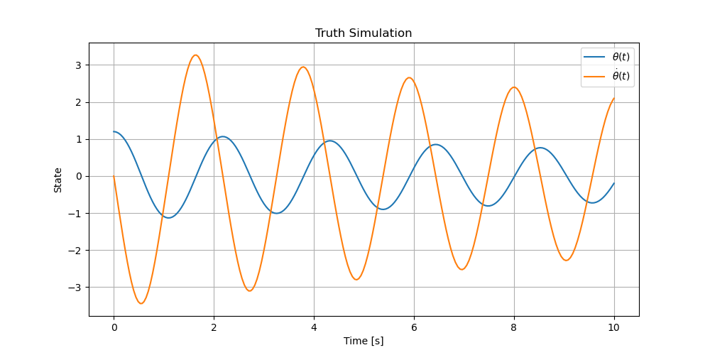
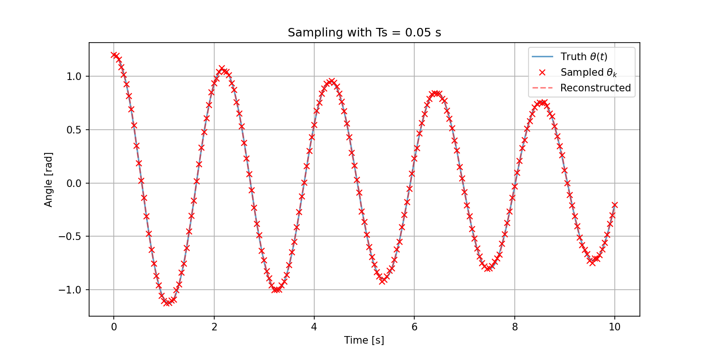
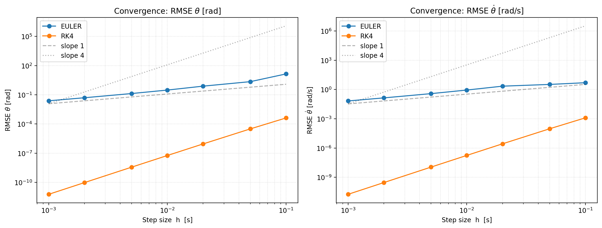
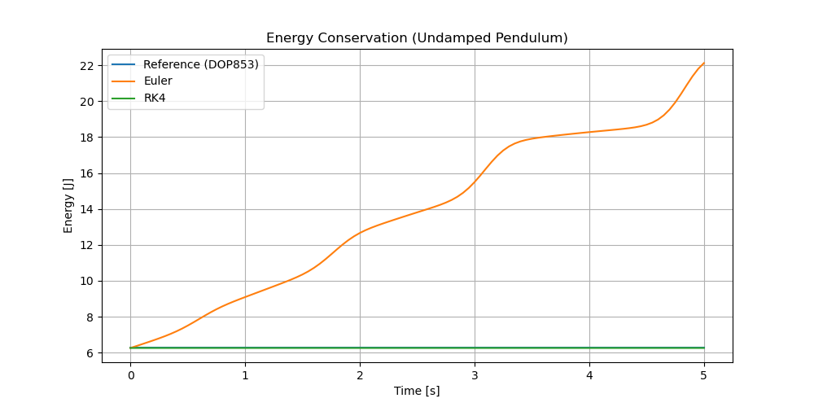

# Pendulum Simulator, Noisy Measurements, and Sampling Effects Report

## 1. Physical System Description and Assumptions
We model a simple pendulum consisting of a point mass $m$ attached to a massless rigid rod of length $L$. The angular displacement $\theta(t)$ is measured from the downward vertical position. We assume a uniform gravitational field $g$, viscous damping with a coefficient $b$ opposing the motion, and an optional externally applied torque $\tau(t)$. The assumptions include treating the mass as a point particle, neglecting air resistance other than the modeled linear viscous damping, and assuming an inextensible rod.

## 2. Derivation of Equations of Motion
Using Newton's Second Law for rotation about the pivot point, the sum of the torques $\sum \tau = I \ddot{\theta}$ is:
$$ \tau_{gravity} + \tau_{damping} + \tau_{external} = (m L^2) \ddot{\theta} $$
$$ -mgL\sin\theta - b\dot{\theta} + \tau(t) = mL^2\ddot{\theta} $$
Rearranging gives the nonlinear second-order ordinary differential equation:
$$ mL^2\ddot{\theta} + b\dot{\theta} + mgL\sin\theta = \tau(t) $$

The natural frequency for small angles ($\sin\theta \approx \theta$) is $\omega_n = \sqrt{g/L}$. The damping ratio is defined as $\zeta = \frac{b}{2mL^2\omega_n}$. The small-angle approximation holds for $|\theta| \ll 1$ radian, and fails for larger angles where the nonlinear effects of $\sin\theta$ are prominent.

## 3. State-Space Representation
We define the state vector as $x_1 = \theta$ and $x_2 = \dot{\theta}$. The second-order ODE can be rewritten as a system of two first-order ODEs:
$$ \dot{x}_1 = x_2 $$
$$ \dot{x}_2 = -\frac{g}{L}\sin x_1 - \frac{b}{mL^2}x_2 + \frac{1}{mL^2}\tau(t) $$

## 4. Numerical-Method Descriptions
We compare three distinct numerical integration techniques to solve this system:
1. **Explicit Euler**: A first-order method, calculating the next state using just the derivative at the current time: $y_{n+1} = y_n + h f(t_n, y_n)$.
2. **Runge-Kutta 4 (RK4)**: A fourth-order method, calculating four intermediate slopes and taking their weighted average to achieve higher accuracy per step.
3. **Adaptive DOP853**: An explicit Runge-Kutta method of order 8(5,3) that uses adaptive step sizing based on local error estimates (controlled by absolute and relative tolerances).

## 5. Truth-Simulation Setup and Convergence Check
The "truth" reference trajectory uses the highly accurate DOP853 integrator with strict tolerances (`rtol=1e-12`, `atol=1e-14`) and dense output to evaluate the exact trajectory continuously. 
The simulation models the baseline parameters $m=1.0\text{ kg}$, $L=1.0\text{ m}$, $g=9.81\text{ m/s}^2$, and $b=0.1\text{ N}\cdot\text{m}\cdot\text{s}$, starting from an initial angle $\theta(0) = 1.2\text{ rad}$.

## 6. Measurement-Noise Model
In a real-world scenario, we assume only the position $\theta$ is read by a digital encoder, subject to zero-mean Gaussian measurement noise $v_k \sim \mathcal{N}(0, \sigma_\theta^2)$ with $\sigma_\theta = 0.01$ rad. The sampled measurement becomes:
$$ \theta_k = \theta(k T_s) + v_k $$
where $T_s$ is the sampling period.

## 7. Sampling Study
We varied $T_s$ from 0.001 s to 0.5 s and compared the reconstructed position and numerically differentiated velocity $\hat{\dot{\theta}}_k \approx \frac{\theta_{k+1}-\theta_k}{T_s}$ to the truth.

| $T_s$ [s] | $f_s$ [Hz] | Nyquist $f_N$ [Hz] | Pos RMSE | Vel RMSE | Aliasing? |
|----------:|-----------:|-------------------:|---------:|---------:|:---------:|
| 0.001     | 1000.0     | 500.0              | 0.0099   | 14.0011  | No        |
| 0.005     | 200.0      | 100.0              | 0.0100   | 2.8098   | No        |
| 0.01      | 100.0      | 50.0               | 0.0104   | 1.4818   | No        |
| 0.02      | 50.0       | 25.0               | 0.0101   | 0.7061   | No        |
| 0.05      | 20.0       | 10.0               | 0.0101   | 0.3274   | No        |
| 0.1       | 10.0       | 5.0                | 0.0094   | 0.3275   | No        |
| 0.2       | 5.0        | 2.5                | 0.0097   | 0.6060   | No        |
| 0.5       | 2.0        | 1.0                | 0.0096   | 1.5835   | No        |

**Noise Amplification in Velocity:** Notice that while position RMSE is tightly clustered around the noise standard deviation ($\sim 0.01$), the velocity RMSE explodes at very high sampling rates ($T_s=0.001$). This is because finite differencing amplifies the high-frequency measurement noise as $T_s$ approaches zero: variance of the difference scales as $2\sigma_\theta^2 / T_s^2$.

## 8. Aliasing Analysis
The natural frequency of our pendulum is roughly $f_n = \frac{1}{2\pi}\sqrt{\frac{9.81}{1.0}} \approx 0.5$ Hz. The Nyquist frequency $f_N$ must be at least twice the highest frequency present in the system to prevent aliasing. In our slowest sampling case ($T_s = 0.5$ s), $f_N = 1.0$ Hz, which is just high enough to avoid aliasing the primary fundamental frequency. If we sampled at $T_s = 1.5$ s, we would begin to see misleading apparent frequencies (aliasing) because the sampling rate would be too slow to capture the pendulum's periodic oscillations.

## 9. Integrator Comparison
By computing errors relative to the DOP853 truth, we see log-log convergence scaling.

Euler converges with a slope of 1 (first-order $\mathcal{O}(h)$), while RK4 converges with a slope of 4 (fourth-order $\mathcal{O}(h^4)$). For example, at $h=0.01$ s, Euler has a position RMSE of $\approx 0.30$ rad, whereas RK4 drops to $\approx 5.7\times 10^{-8}$ rad.

## 10. Energy-Conservation Analysis
For the undamped case ($b=0$), total mechanical energy $E(t) = \frac{1}{2}mL^2\dot{\theta}^2 + mgL(1-\cos\theta)$ should be strictly conserved. 

The explicit Euler method adds energy artificially at every step due to its explicit linearization, causing the system's energy to rapidly blow up. RK4 matches the reference solution extremely well and essentially conserves energy over short horizons (although over very long simulations it may eventually drift slightly compared to symplectic integrators).

## 11. Limitations and Real-World Considerations
1. **Actuator limitations:** We assumed infinite bandwidth for the torque input, which is unrealistic for physical motors.
2. **Measurement resolution:** Real digital encoders are quantized to specific bit resolutions, introducing quantization noise beyond standard Gaussian assumptions.
3. **Friction:** We assumed simple viscous damping, whereas actual physical pendulums often exhibit Coulomb dry friction or stiction at the pivot.

## 12. Conclusions
This project demonstrates the core elements of computational system modeling: converting physical differential equations into state space, implementing numerical simulations, and interpreting digital measurements. The choice of integrator (e.g., RK4 over Euler) drastically affects simulation accuracy and stability. Finally, finding the optimal sampling rate is a trade-off: sampling too slowly risks losing dynamics (and aliasing), while sampling too fast dramatically amplifies noise in numerical derivatives.
